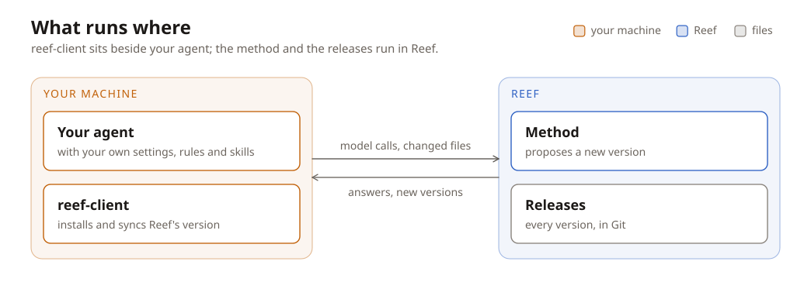

Tutorial: evolve your agent's harness
=====================================

:For: anyone who wants Reef to improve the coding agent they already use
:Before you start: a Reef checkout (`Laptop, no GPU <installation.rst#laptop-no-gpu>`__), Node.js with ``npm``, and an API key for a model that can call tools
:You will have: Reef running, your agent connected to it, and a training step that Reef ran from your feedback

A coding agent's harness is everything around the model: its rules, skills,
commands and settings. Reef learns a better harness from how the agent does
its work, and gives each new version back to you. Your own configuration
stays as it is.

In this tutorial you start Reef, connect the pi agent to it, use the agent,
tell Reef how a session went, and see what Reef does with it.

.. container:: flow

   Use
       you run the agent; its model calls go through Reef

   Record
       Reef keeps each call and the feedback on it

   **Evolve**
       a method edits a copy of the harness

   Evaluate
       the copy and the current version run the same tasks

   Publish
       a better copy becomes the current version

   :Loop: your next session starts on the new version

What runs where
---------------

Two programs share the work. ``reef-client`` runs on your machine, next to
the agent. Reef runs as a service, on the same machine or on a server.

   The client installs Reef's version beside your own configuration and sends
   back what a session changed. Reef records the calls, evolves the harness,
   and publishes versions.

Each version of the harness is a *harness tree*: a directory of text files
such as ``rules.md`` and ``skills/<name>/SKILL.md``. Reef stores every
version as a *release*. The newest one is the *head*.

Start Reef
----------

From the repository root, point Reef at your model and start the example
deployment. It evolves the rules of the pi agent.

.. code:: bash

   export REEF_UPSTREAM_URL=https://api.moonshot.ai   # without /v1
   export REEF_UPSTREAM_MODEL=kimi-k2.6
   export REEF_UPSTREAM_API_KEY=sk-...
   reef serve -c tutorials/evolve-your-harness/configs/deployment.yaml

Reef is ready when ``curl http://127.0.0.1:8901/healthz`` answers
``{"ok": true}``. The deployment names the agent, the method, and the tasks
that every new version must pass.

Connect your machine
--------------------

Pick a name for your harness. Everyone who connects to the same name shares
one harness.

.. code:: bash

   pip install reef-client
   export SCENARIO=my-agent
   reef-client harness connect $SCENARIO --reef http://127.0.0.1:8901

``connect`` prints ``Done. Open a new terminal and run pi.`` It put the
newest version under ``~/.local/share/reef-client/harness/my-agent``,
installed it as a pi package with ``pi install``, installed pi if your
machine lacked it, and made your ``pi`` command run through Reef. Your own
rules and settings stay as they are; ``reef-client harness disconnect``
removes the package. When the deployment needs a token, ``connect`` asks
for it, or reads ``REEF_TOKEN``.

Use the agent
-------------

Open a new terminal, run ``pi`` as you always do, and give it a task. pi
loads your own configuration and Reef's package. Every pi session loads the
package, but only a session that starts through Reef sends its model calls
to Reef, which records each one. After pi exits, the client sends back what
the session changed in Reef's files.

Tell Reef how it went
---------------------

Reef learns from calls that have feedback. Score the session with one report
that names its model calls: ``0`` for a failure, ``1`` for a success. The
``feedback`` text says what went wrong. The commands use ``jq``.

.. code:: bash

   CALLS=$(curl -s "http://127.0.0.1:8901/reef/scenarios/$SCENARIO/records?request_type=inference&limit=100" \
     | jq -c '[.records[].agent_record_id]')
   curl -s -X POST http://127.0.0.1:8901/reef/report \
     -H "x-reef-scenario: $SCENARIO" -H "Content-Type: application/json" \
     -d "{\"references\": $CALLS, \"score\": 0, \"feedback\": \"it said the test passed without running it\"}"

With a deployment token, add ``-H "Authorization: Bearer $REEF_TOKEN"`` to
each ``curl``. A program that calls the model itself reads each call's
record id from the ``x-reef-agent-record-id`` header.

What Reef does next
-------------------

This deployment starts a training step for each report. The step does not
change the head directly. It makes a candidate and tests it first.

.. container:: flow

   Copy
       the method gets a copy of the head and your session

   **Edit**
       it writes new rules from what went wrong

   Check
       Reef refuses files the agent cannot read

   Evaluate
       candidate and head run the same tasks

   Decide
       the better one is the head

A winning candidate becomes the new head, and your next ``pi`` session
starts on it. List the steps and their results:

.. code:: bash

   curl -s -H "x-reef-scenario: $SCENARIO" http://127.0.0.1:8901/reef/harness/releases

Each step has a page, ``/reef/harness/releases/<step>/page``. A change to
code, such as a pi extension, waits for you to promote it.

When you and Reef change the same file
--------------------------------------

You can edit Reef's files too, for example the rules in
``~/.local/share/reef-client/harness/my-agent/plugin/rules.md``. The client
sends your edit with the next sync, and Reef merges it onto the active release. Text
files merge line by line:

+---------------------------------+--------------------------------------+
| You changed                     | Result                               |
+=================================+======================================+
| nothing                         | Reef's version                       |
+---------------------------------+--------------------------------------+
| a line that Reef did not change | both changes                         |
+---------------------------------+--------------------------------------+
| the same line that Reef changed | a conflict; your file stays as it is |
+---------------------------------+--------------------------------------+

A conflict names the file. Make the line match one side and run
``reef-client harness sync``, or run ``reef-client harness sync --discard``
to take Reef's version. Code files do not merge by line: a code file that
both sides changed is a conflict.

Next steps
----------

- `Write a harness method <../developer-guide/write-a-harness-method.rst>`__:
  change more than the rules. This deployment's method, ``RulesMethod`` in
  ``tutorials/evolve-your-harness/harness/plugins.py``, rewrites
  ``rules.md`` only.
- `Evolve your harness <../user-guide/evolve-your-harness.rst>`__: the
  deployment settings, offline runs on uploaded tasks, and reviews.
- `Harness adapters <../developer-guide/harness-adapters.rst>`__: connect an
  agent other than pi, Claude Code, opencode and codex.
- `Recipes <../user-guide/recipes.rst>`__: GEPA, Meta-Harness and the other
  methods that come with Reef.
