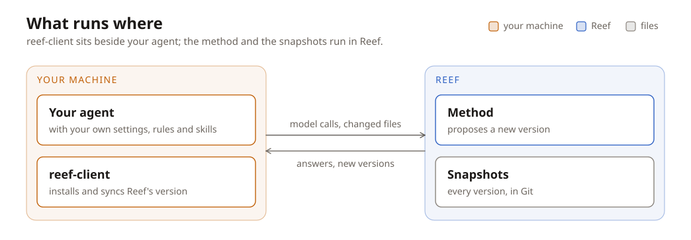

Tutorial: evolve your agent's harness
=====================================

Connect pi to Reef and use session feedback to update its rules.
Reef evaluates proposed rules before it selects a new version.

You need:

- A Reef checkout. Follow `Laptop, no GPU <installation.rst#laptop-no-gpu>`__.
- Node.js with ``npm``, and ``jq``.
- An API key for a model that supports tool calls.

What runs where
---------------

``reef-client`` runs next to the agent. The Reef service can run on the
same machine or on a server.

   The client installs the active harness and returns session changes.
   Reef records model calls, evaluates changes and publishes versions.

A *harness tree* contains files such as ``rules.md`` and
``skills/<name>/SKILL.md``. Reef stores versioned snapshots of this tree.
The client installs Reef's files beside your own configuration.

Start Reef
----------

From the repository root, set your model credentials and start the example:

.. code:: bash

   export REEF_UPSTREAM_URL=https://api.moonshot.ai   # without /v1
   export REEF_UPSTREAM_MODEL=kimi-k2.6
   export REEF_UPSTREAM_API_KEY=sk-...
   reef serve -c tutorials/evolve-your-harness/configs/deployment.yaml

Check readiness with ``curl http://127.0.0.1:8901/healthz``.
The expected response is ``{"ok": true}``.

Connect your machine
--------------------

Choose a scenario name. Clients that connect to the same scenario share its harness.

.. code:: bash

   pip install reef-client
   export SCENARIO=my-agent
   reef-client harness connect $SCENARIO --reef http://127.0.0.1:8901

``connect`` installs pi if needed, adds Reef's harness package and configures
the ``pi`` command to use Reef. It stores files under
``~/.local/share/reef-client/harness/my-agent``.
For an authenticated deployment, it reads ``REEF_TOKEN`` or asks for the token.

Use the agent
-------------

Open a new terminal. Run ``pi`` and give it a task.
pi loads your configuration and Reef's package.
Only sessions started through Reef send their model calls to Reef.
After pi exits, the client syncs changes to Reef's files.

Tell Reef how it went
---------------------

Report ``0`` for a failed session or ``1`` for a successful session.
Name the last model call; Reef includes the earlier calls of that session.
Use ``feedback`` to explain the result.

Return to the terminal where you set ``SCENARIO``. These commands select its newest call.
Run them immediately after the session ends, with no other active clients on that scenario.

.. code:: bash

   (
     set -e
     RECORDS="http://127.0.0.1:8901/reef/scenarios/$SCENARIO/records?request_type=inference&limit=100"
     AFTER=0
     while [ "$AFTER" != null ]; do
       PAGE=$(curl -fsS "$RECORDS&after_sequence=$AFTER")
       AFTER=$(jq '.next_after_sequence' <<< "$PAGE")
     done
     LAST=$(jq -er '.records[-1].agent_record_id' <<< "$PAGE")
     curl -fsS -X POST http://127.0.0.1:8901/reef/report \
       -H "x-reef-scenario: $SCENARIO" -H "Content-Type: application/json" \
       -d "$(jq -n --arg id "$LAST" '{references: [$id], score: 0, feedback: "the test did not run"}')"
   )

For an authenticated deployment, add
``-H "Authorization: Bearer $REEF_TOKEN"`` to each ``curl`` command.
An API client can read the receipt directly from ``x-reef-agent-record-id``.

What Reef does next
-------------------

Each scored report starts a step. A score of 1 records success and keeps the current rules.
For a score below 1, the tutorial method asks the model to revise ``rules.md`` using the failed session.
If the method proposes a change, Reef validates it and compares both trees on the same tasks.
The candidate must win more comparisons than it loses. Otherwise the current rules stay active.

List the steps and their results:

.. code:: bash

   curl -s -H "x-reef-scenario: $SCENARIO" http://127.0.0.1:8901/reef/harness/artifacts

Each step has a page at ``/reef/harness/artifacts/<step>/page``.
A code change, such as a pi extension, waits until you `activate it
<../user-guide/evolve-your-harness.rst#activate-an-inactive-artifact>`__.

When you and Reef change the same file
--------------------------------------

You can edit files such as
``~/.local/share/reef-client/harness/my-agent/plugin/rules.md``.
The next sync applies Reef's updates to unmodified text files.
If you edited different lines, the merge keeps both changes.
If you and Reef edited the same line, sync reports a conflict and preserves your file.

For a conflict, choose the desired content and run ``reef-client harness sync``.
To discard your edits, run ``reef-client harness sync --discard``.
If both sides changed a code file, resolve the whole file.

To remove Reef's package, run ``reef-client harness disconnect``.

Next steps
----------

- `Write a harness method <../developer-guide/write-a-harness-method.rst>`__:
  extend this example's ``RulesMethod``, which updates ``rules.md`` only.
- `Evolve your harness <../user-guide/evolve-your-harness.rst>`__: the
  deployment settings, offline runs on uploaded tasks, and reviews.
- `Harness adapters <../developer-guide/harness-adapters.rst>`__: connect another agent.
- `Recipes <../user-guide/recipes.rst>`__: GEPA, Meta-Harness and the other
  methods that come with Reef.
