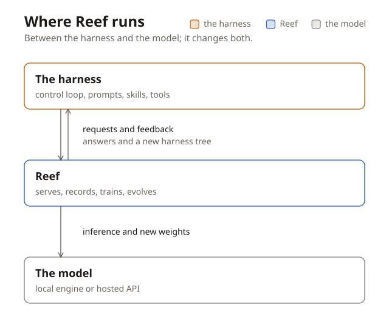

Reef: continual learning for AI agents
======================================

Reef is a continual learning infrastructure. It sits between your agent's
harness and the model that harness calls. It records each request, its
response, and the feedback about the response. Reef then use these signal to
produce a better version of the model weights or of the agent's harness.

   Reef serves the model, loads new weights into the engine, and sends a new
   harness tree to the agent.

Why Reef
--------

AI agents constantly accumulate valuable feedback, from passing tests to user
thumbs-downs and rubric scores. Traditionally, turning these signals into a
smarter agent requires a cumbersome offline pipeline: exporting logs, building
datasets, retraining, evaluating, and redeploying.

Reef eliminates this friction. By integrating continual learning directly into
the serving lifecycle, Reef drastically reduces the complexity of maintaining
offline pipelines.

.. container:: flow

   Serve
       forward the request and keep the exchange

   Record
       store the release that produced the response

   **Learn**
       the recipe uses records to create a candidate version

   Publish
       an accepted candidate becomes the active release

   :Loop: the next request is served by the new version

Existing inference engines and RL frameworks cover parts of that loop, but not
the whole thing:

+----------------------------+-------------+---------------+----------+
| Ability                    | Inference   | RL training   | **Reef** |
|                            | engine      | framework     |          |
|                            | (vLLM,      | (slime, veRL, |          |
|                            | SGLang, …)  | AReaL, …)     |          |
+============================+=============+===============+==========+
| Serves live traffic        | ✓           | ✗             | ✓        |
+----------------------------+-------------+---------------+----------+
| Trains weights             | ✗           | ✓             | ✓        |
+----------------------------+-------------+---------------+----------+
| Versions what it served    | ✗           | ✗             | ✓        |
+----------------------------+-------------+---------------+----------+
| Stays live through updates | ✗           | ✗             | ✓        |
+----------------------------+-------------+---------------+----------+
| Evolves beyond weights     | ✗           | ✗             | ✓        |
| (skills, harness)          |             |               |          |
+----------------------------+-------------+---------------+----------+

What Reef evolves
--------------------

Reef is capable of evolve both the model weights and the `harness tree
<../reference/glossary.rst#harness-tree>`__, controlled by a `recipe
<../reference/glossary.rst#recipe>`__.

- **Model weights.** Reef runs the training step and hot-swaps the result
  into the serving engine. See `Evolve your model
  <../user-guide/evolve-your-model.rst>`__.
- **The harness tree.** Reef proposes an edit, runs the current and proposed
  versions on your tasks, and keeps the winner. Adapters cover pi, opencode,
  Claude Code, Codex, DeepSeek Harness, Hermes Agent, Terminus 2, and Reef's
  own native harness, whose tools, hook listeners, and loop graph evolve too.
  See `Evolve your harness <../user-guide/evolve-your-harness.rst>`__.

Start using Reef
----------------

Follow the `inference and feedback quickstart <quickstart.rst>`__ to run
Reef locally and submit your first report. Then `choose a learning recipe
<../user-guide/recipes.rst>`__ for your workload and compute budget.
