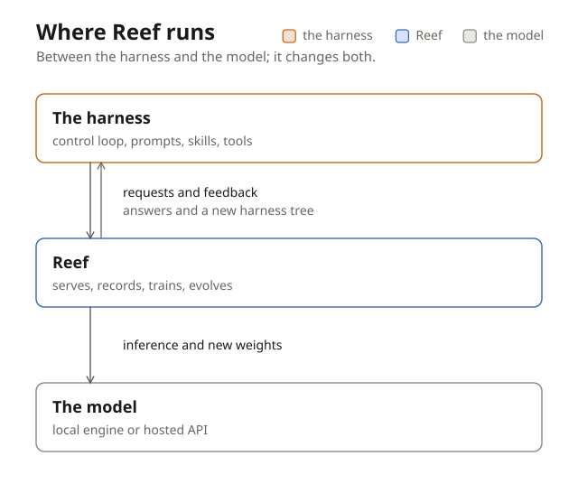

Reef: continual learning for AI agents
======================================

Use Reef to train model weights or update an agent harness from feedback.
Reef records model requests, responses and feedback. A recipe uses these
records to produce, evaluate and select new versions.

   Reef connects model inference, feedback and versioned updates.

Why Reef
--------

Connect your existing tests, graders or user feedback to this loop:

.. container:: flow

   Serve
       forward the model request

   Record
       store the exchange and the version that served it

   **Learn**
       use feedback to create a candidate version

   Publish
       make an accepted candidate available to the agent

   :Loop: collect feedback on the next version

What Reef evolves
-----------------

- **Model weights.** Train from agent feedback and load accepted weights
  into the inference engine. See `Evolve your model
  <../user-guide/evolve-your-model.rst>`__.
- **The harness tree.** Update the agent's prompts, rules, skills or code.
  Compare candidates on your tasks and publish the selected version.
  See `Evolve your harness <../user-guide/evolve-your-harness.rst>`__.

A `recipe <../reference/glossary.rst#recipe>`__ defines the learning method.

Start using Reef
----------------

- `Record inference and feedback <quickstart.rst>`__: start a local service
  and send your first report.
- `Evolve a coding agent's harness <harness-tutorial.rst>`__: connect an agent
  and use feedback to update its rules.
- `Choose a recipe <../user-guide/recipes.rst>`__: select a method for your
  feedback and compute resources.
