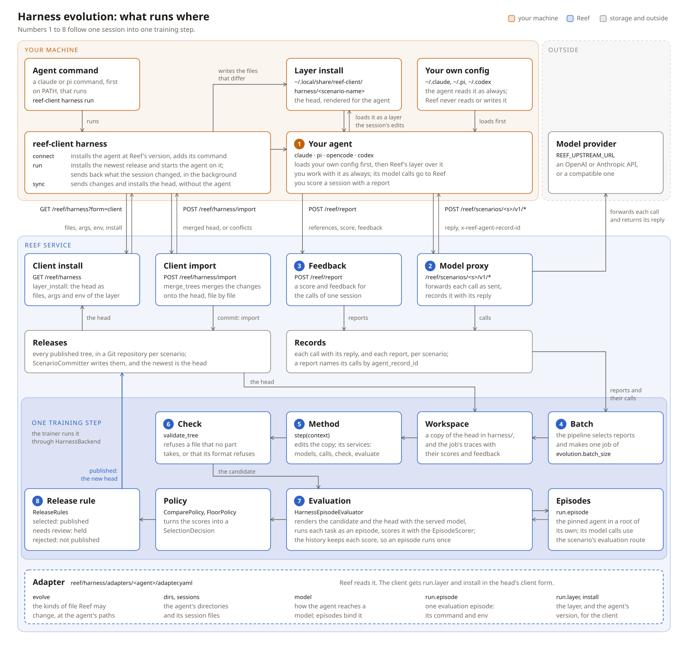

Evolve your harness
===================

A harness is everything around the model: rules, skills, commands, tools,
config and extension code. Harness evolution improves the harness while the
model weights stay fixed, so it needs no GPU and works with a closed model
endpoint. It fits when the problem is in the text around the model, not when
the model cannot do the task.

A deployment chooses three things:

.. list-table::
   :header-rows: 1
   :widths: 30 70

   * - Key
     - Chooses
   * - ``evolution.adapter``
     - the agent (see `The harness tree`_)
   * - ``evolution.method``
     - how a step changes the tree (see `Choose or write a method`_)
   * - ``evolution.evaluation``
     - whether a change is published (see `Evaluation: the publication policy`_)

How it works
------------

   The client installs the active release as the agent's own plugin, beside the
   person's own configuration, and sends back what a session changed. Reef
   records the model calls and reports, runs a training step on a batch of
   reports or of uploaded train tasks, and makes a selected candidate the new
   head, which the activation rule activates.

.. list-table::
   :header-rows: 1
   :widths: 8 92

   * - Step
     - What happens (the numbers of the figure)
   * - 1
     - ``reef-client harness run`` installs the active release and starts the
       agent on the person's own configuration plus the release.
   * - 2
     - The agent's model calls go to ``/reef/scenarios/<scenario>/v1/*``.
       Reef forwards and records each one. When the agent exits, the client
       sends the files that the session changed.
   * - 3
     - The person, or a program that checks the work, scores the session with
       ``POST /reef/report``.
   * - 4
     - When ``job_samples`` traces wait (``pipeline.sample2job.config``,
       default 1), a training step starts.
   * - 5
     - The method edits a copy of the head, the training start: the newest
       release that a step kept or that a sync committed (``step(context)``).
   * - 6
     - Reef checks the new tree. An unchanged or invalid tree skips the step.
   * - 7
     - The candidate and the head play the same tasks, and the policy
       compares their scores.
   * - 8
     - A selected candidate becomes a new release and the new head. The
       activation rule serves it at once, or leaves it inactive until a
       person activates it.

Two ways to evolve
~~~~~~~~~~~~~~~~~~

Both ways feed the same training step (4 to 8).

.. list-table::
   :header-rows: 1
   :widths: 16 42 42

   * - What
     - Online: learn from sessions
     - Offline: learn from uploaded tasks
   * - Traces
     - sessions that people run and score
     - runs of the next train tasks, run on the head
   * - Evaluation tasks
     - instructions in ``evolution.evaluation.tasks``, or none (``policy: none``)
     - the eval split of the uploaded tasks
   * - Agents
     - ``claude``, ``pi``, ``opencode``, ``codex`` (the adapters with a plugin)
     - every adapter with an npm ``install``
   * - Recipes
     - ACE, ReasoningBank, GEPA (AIME example)
     - GEPA with ``TrainTaskJobData``, Meta-Harness (Terminal-Bench example)

Quickstart
----------

You need a Reef checkout (`Laptop, no GPU
<../getting-started/installation.rst#laptop-no-gpu>`__), ``pip install
reef-client``, a model endpoint that can call tools, and Node with ``npm``.
The offline way also needs Docker. At startup, the deployment installs the
adapter's pinned agent under ``~/.local/share/reef-harness/<adapter>``, or
uses ``evolution.binary``. The tutorial's deployment listens on
``127.0.0.1:8901`` without a token; with one, add ``-H "Authorization:
Bearer $REEF_TOKEN"`` to each ``curl``.

Online: learn from your sessions
~~~~~~~~~~~~~~~~~~~~~~~~~~~~~~~~

.. code:: bash

   export REEF_UPSTREAM_URL=https://api.moonshot.ai   # without /v1
   export REEF_UPSTREAM_MODEL=kimi-k2.6
   export REEF_UPSTREAM_API_KEY=sk-...
   reef serve -c tutorials/evolve-your-harness/configs/deployment.yaml

   # On your machine: connect once, then use pi as you always do.
   reef-client harness connect <scenario> --reef http://127.0.0.1:8901
   pi

   # Score the session over its model calls: 0 fails, 1 succeeds.
   CALLS=$(curl -s "http://127.0.0.1:8901/reef/scenarios/<scenario>/records?request_type=inference&limit=100" \
     | jq -c '[.records[].agent_record_id]')
   curl -s -X POST http://127.0.0.1:8901/reef/report \
     -H "x-reef-scenario: <scenario>" -H "Content-Type: application/json" \
     -d "{\"references\": $CALLS, \"score\": 0, \"feedback\": \"it said the test passed without running it\"}"

   # The steps and their results; a row with "selected": true is a new release.
   curl -s -H "x-reef-scenario: <scenario>" http://127.0.0.1:8901/reef/harness/releases

The next ``pi`` session starts on the new active release. `Tutorial: evolve your
agent's harness <../getting-started/harness-tutorial.rst>`__ walks through
these steps.

Offline: learn from uploaded tasks
~~~~~~~~~~~~~~~~~~~~~~~~~~~~~~~~~~

Change the deployment's evaluation and add a ``pipeline`` section:

.. code:: yaml

   recipe:
     config:
       evolution:
         evaluation:
           imported_tasks: true
           scorer: reef.evaluation.harness:VerifierRewardScorer
           policy: compare
   pipeline:
     sample2job:
       module: reef.sample2job.traces:TrainTaskJobData
       config: {buffer_size: 4}

Then upload Harbor task directories as task items of the scenario's owner,
which is the scenario's own name unless it was given another. Each item's
metadata names the scenario and the split. The first train task starts the
run:

.. code:: bash

   tar -czf train.tar.gz -C <tasks-directory> <task-a> <task-b>
   curl -f "http://127.0.0.1:8901/reef/namespaces/<scenario>/data/tasks" \
     --get --data-urlencode 'metadata={"scenarios": {"<scenario>": "train"}}' -X POST \
     -H "Content-Type: application/gzip" --data-binary @train.tar.gz
   tar -czf eval.tar.gz -C <tasks-directory> <task-c>
   curl -f "http://127.0.0.1:8901/reef/namespaces/<scenario>/data/tasks" \
     --get --data-urlencode 'metadata={"scenarios": {"<scenario>": "eval"}}' -X POST \
     -H "Content-Type: application/gzip" --data-binary @eval.tar.gz

Run the example
~~~~~~~~~~~~~~~

The example runs the online way without a person:

.. code:: bash

   export REEF_UPSTREAM_API_KEY=sk-...    # only if your endpoint needs one
   cd tutorials/evolve-your-harness && ./run.sh

``configs/serve.yaml`` holds the endpoint, the model and the token. Three
exact-answer tasks go through Reef, and each graded reply is one step. The
run succeeds when a row of ``/reef/harness/releases`` shows ``selected:
true``. When both sides score nothing, no run gave an answer: vLLM, for
example, needs ``--enable-auto-tool-choice --tool-call-parser hermes``. See
`Troubleshooting <troubleshooting.rst>`__.

The harness tree
----------------

A harness tree is one directory of text files. Each release holds one tree,
and each step changes it with a patch: paths mapped to their new text, or to
``null`` for a removal. Every adapter uses the same tree path for the same
part:

.. list-table::
   :header-rows: 1
   :widths: 34 18 48

   * - Path
     - Part
     - Holds
   * - ``rules.md``
     - ``rules``
     - the text every session reads
   * - ``skills/<name>/SKILL.md``
     - ``skill``
     - an Agent Skill
   * - ``commands/<name>.md``
     - ``command``
     - a prompt template a person types as a command
   * - ``extensions/<name>.<ext>``
     - ``extension``
     - code the agent loads
   * - ``config/<target>.json``
     - ``config``
     - keys merged into one of the agent's config files
   * - ``native/{tools,hooks,graphs,agents,loops}/<name>``
     - ``native_*``
     - the native loop's tools, hooks, control flow, subagents and loop code

.. list-table::
   :header-rows: 1
   :widths: 14 22 64

   * - Adapter
     - Agent
     - Parts
   * - ``pi``
     - pi coding agent
     - rules, skill, command, extension, config (an empty ``defaultTools``)
   * - ``opencode``
     - OpenCode
     - rules, skill, command, extension, config
   * - ``claude``
     - Claude Code
     - rules, skill, command, extension (with ``config/hooks.json``)
   * - ``codex``
     - Codex CLI
     - skill, command
   * - ``dsh``
     - DeepSeek Harness
     - rules, skill, command, extension, config
   * - ``hermes``
     - Hermes Agent
     - rules, skill, command, extension, config
   * - ``native``
     - Reef's own loop
     - rules, skill, config, and the five ``native_*`` parts

For the first four, the parts are what the agent's own plugin carries: the
same plugin runs in the evaluation and on a person's machine. Reef refuses a
file at a path that no part takes. A tree never chooses where
model calls go: Reef writes the endpoint, key and model at render time. The
adapter guide gives each adapter's `render paths
<../developer-guide/harness-adapters.rst#render-paths>`__ and `model binding
checks <../developer-guide/harness-adapters.rst#model-binding-checks>`__.

The loop
--------

``T`` is a harness tree, and ``A`` is the deployment's adapter.

.. list-table::
   :header-rows: 1
   :widths: 14 60 26

   * - Part
     - What it does
     - Details
   * - Data
     - Records and uploaded tasks give ``D``, one step's traces or train
       tasks.
     - `Step data`_
   * - Evolve
     - ``method(T, D, s) = (T', s')``: the candidate ``T'`` and the method's
       new state.
     - `Write a harness method <../developer-guide/write-a-harness-method.rst>`__
   * - Evaluation
     - Runs of ``T'`` and ``T`` on the same tasks; the policy selects or
       rejects ``T'``.
     - `Evaluation: the publication policy`_
   * - Release
     - A selected ``T'`` becomes a git release and the head; the activation
       rule decides whether it serves.
     - `Activate an inactive release`_
   * - Sync
     - A client installs ``render_A(T)`` and sends back what a session
       changed; Reef merges it onto the active release and commits a sync, which
       serves at once and becomes the training start.
     - `Use a published tree`_

Step data
~~~~~~~~~

A step starts when ``pipeline.sample2job.config.job_samples`` traces wait
(default 1). One trace is one scored report, with every model call it names.
To learn from inference traffic without reports, name the inference stage;
each call is then one unscored trace:

.. code-block:: yaml

   pipeline:
     record2sample: {module: reef.record2sample.traces:InferenceSamples}

Offline runs on uploaded tasks
~~~~~~~~~~~~~~~~~~~~~~~~~~~~~~

``reef.sample2job.traces:TrainTaskJobData`` makes each step from the train
split of the scenario's imported tasks:

- Each uploaded train task joins the buffer and trains once, in upload
  order. A step of train tasks runs up to ``buffer_size`` of them (default
  ``job_samples``) on the head, and the method reads those runs.
- A step holds either traces or train tasks, so recorded sessions still
  start their own steps.
- The eval split is the evaluation's task source. The stage needs a scorer
  and task directories (see `Task directories`_).

Upload tasks as task items whose metadata names the scenario in the ``train``
or ``eval`` split (`Create task items
<../reference/http-api.rst#create-task-items>`__), or import them with the
deployment's ``task-import`` section.

Evaluation: the publication policy
~~~~~~~~~~~~~~~~~~~~~~~~~~~~~~~~~~

``evolution.evaluation`` names the tasks, the ``scorer`` (an
``TaskScorer``) and the ``policy``. The tasks come from ``tasks`` (prompts
or task directories), ``task_manifest`` with ``tasks_root``, or
``imported_tasks``. A prompt run starts in an empty root, so a prompt must
state the whole problem.

.. list-table::
   :header-rows: 1
   :widths: 14 40 46

   * - Policy
     - Runs
     - Publishes the candidate when
   * - ``compare``
     - the candidate and the head, ``repeats`` times per task
     - ``statistic: wins`` (default): it wins more than ``min_margin``
       pairings beyond its losses; ``statistic: mean``: its mean beats the
       head's by more than ``min_margin``
   * - ``floor``
     - the candidate only
     - every run that completed scores at least ``floor_score``, and every task
       has such a run
   * - ``none``
     - nothing
     - always; it needs no tasks and no scorer

A run that gave no answer scores 0. A failed run, one that the
environment could not run, counts for neither tree: ``wins`` drops its pair
and ``mean`` leaves it out. A tie publishes nothing. Reef keeps every scored run and reuses it for the same tree,
task and repeat, so a step usually runs only the candidate's runs.
`Harness evolution keys <../reference/configuration.rst#harness-evolution-keys>`__
lists every key.

Running runs
^^^^^^^^^^^^^^^^

.. list-table::
   :header-rows: 1
   :widths: 20 80

   * - ``evolution.executor``
     - Where a task runs
   * - ``local`` (default)
     - a plain subprocess, with no isolation; for development
   * - ``sandbox``
     - a bubblewrap jail: read-only base, explicit credentials only, no
       network unless ``evolution.sandbox.egress_hosts`` is set
   * - ``e2b``, ``modal``
     - one cloud sandbox per run (``reef-infra[e2b]`` or
       ``reef-infra[modal]``), with outbound internet

``evolution.sandbox.env_from`` lists the only variables a run gets. See
`Sandbox environments <../developer-guide/sandboxes.rst>`__.

Task directories
^^^^^^^^^^^^^^^^

A Harbor task directory holds an instruction, an environment and tests. Reef
runs each one in its own container: Harbor starts it, Reef installs the
adapter's pinned agent with npm and copies in the rendered tree, the agent
plays the instruction, and the tests' reward is the score
(``VerifierRewardScorer``). The image needs glibc.

The agent reaches Reef at ``evolution.evaluation.agent_host`` (default
``host.docker.internal``) in place of a loopback address. On Linux, set it
to an address the container reaches, such as the Docker bridge gateway.
Startup refuses task directories when the adapter has no npm ``install``,
when the executor is not ``local``, or with ``collect_failures``. An offline
run's evaluation tasks must be directories too.

Collection: growing evaluation suite
^^^^^^^^^^^^^^^^^^^^^^^^^^^^^^^^^^^^

``collect_failures: true`` makes the prompts of each step's traces permanent
evaluation tasks, so a later candidate cannot bring an old failure back. Reef
screens each prompt, and caps them at ``max_collected_per_client`` (5) and
``max_collected_tasks`` (50). A ``TaskCollector`` chooses which prompts
(`Collect traffic prompts
<../developer-guide/write-a-harness-method.rst#collect-traffic-prompts>`__).

History
~~~~~~~

- ``GET /reef/harness/releases`` has a row per step: the patch, the scores,
  the method's summary and its cost. ``/reef/harness/releases/<step>/page``
  explains one step.
- ``<evolution.state_dir>/<scenario>/harness/`` keeps ``history/`` (every
  tree, run and decision; the score cache) and ``steps/<step>/`` (each
  workspace and its model calls). Nothing prunes it, and it holds client
  traffic: protect it.

Use a published tree
--------------------

``reef-client harness`` installs the active release as your agent's own
plugin, with the agent's own command, so every session of the agent loads it
beside your own configuration. A session that starts through Reef also sends
its model calls to Reef. To go back to an earlier release, activate it
(`Activate an inactive release`_); your next sync installs it.
The deployment's ``evolution.adapter`` decides the agent; ``GET
/reef/scenarios`` lists each harness with its ``adapter``.

.. code:: bash

   pip install reef-client
   reef-client harness connect --reef http://127.0.0.1:8900

.. container:: flow

   connect
       sets the machine up, once

   run
       syncs, starts the agent with its model calls on Reef, and sends its changes when it exits

   **Reef**
       records each model call; steps publish releases

   :Loop: each run starts on the active release

.. list-table::
   :header-rows: 1
   :widths: 18 82

   * - Command
     - What it does
   * - ``connect``
     - Installs the active release under ``~/.local/share/reef-client/harness/<scenario>``
       and as the agent's plugin, installs the pinned agent when the machine
       lacks it, and makes the agent's own command run through Reef. It asks
       only for a token and a harness when it must.
   * - ``run``
     - Syncs (waiting at most 2 s for Reef), starts the agent with its model
       calls on Reef, and sends the session's changes from the background when
       it exits. Arguments after ``--`` go to the agent.
   * - ``sync``
     - Sends your changed files, then installs the result. Reef merges them
       onto the active release by each part's ``merge``: text by line, code by file.
       It commits the merged tree as a sync: one commit makes it a new
       release, the active release and the next step's training start.
       ``--discard`` drops your files.
   * - ``status``
     - Shows the installed release, the active release and the changed
       files.
   * - ``disconnect``
     - Removes the plugin, the install and the agent command.

.. list-table::
   :header-rows: 1
   :widths: 12 88

   * - Agent
     - The release, as your agent's plugin
   * - ``claude``
     - The plugin ``reef``: skills and commands as ``reef:<name>``, the rules
       as its output style, the extensions as its hooks.
   * - ``pi``
     - A pi package: skills, prompts and extensions beside yours, the rules
       after your system prompt.
   * - ``opencode``
     - A global plugin: rules, skills, commands and config merged over yours.
       opencode has no command that removes a plugin, so its entry stays after
       ``disconnect`` and loads nothing.
   * - ``codex``
     - The plugin ``reef`` in ``~/.codex``: skills and commands as
       ``$reef:<name>``.

Reef never reads your own configuration, and evaluates each release without
it. Your configuration still reaches the model calls that Reef records, such
as your rules and the names of your skills.

A client of its own uses ``GET /reef/harness`` (``?release_id=`` for an
older release, ``?form=source``, or ``?form=client&service_url=&root=`` for
the plugin and its commands) and ``POST /reef/harness/import``, which
commits a sync (see `HTTP API
<../reference/http-api.rst#importing-a-harness>`__).

Activate an inactive release
~~~~~~~~~~~~~~~~~~~~~~~~~~~~

Tree code runs with your privileges. To make a person approve a change, set
the deployment's top-level ``activation`` section (`Configuration
<../reference/configuration.rst#the-activation-section>`__):

- ``module: never`` leaves every win inactive.
- ``module: always`` with ``config: {review_kinds: [extension]}`` leaves
  inactive only the wins that touch those kinds. The other wins serve at
  once.
- A kind that is always reviewed, such as native's ``native_loop``, always
  waits.

An inactive release sits in ``GET /reef/harness/releases`` with ``active:
false`` and ``activated: false``, and Reef serves it to no client. The next
steps train from it in the meantime. To serve it, send the row's
``artifact_id`` to the activate route. The same route serves an earlier
release again. Clients install the active release at their next sync:

.. code:: bash

   curl -sS -X POST -H "Content-Type: application/json" -d '{"artifact_id": "<artifact_id>"}' \
     http://127.0.0.1:8901/reef/scenarios/<scenario>/activate

`Activate an artifact <operate.rst#activate-an-artifact>`__ describes
activation, and `Train from an artifact
<operate.rst#train-from-an-artifact>`__ describes how to make the steps train
from another release.

Serve the harness as a resident process
---------------------------------------

The native agent can run as one process that follows the scenario's active
release and mounts each new one between two steps:

.. code:: bash

   mkdir -p reef-harness/native
   printf '{"api": "openai", "base_url": "http://127.0.0.1:8900", "api_key": "%s", "model": "qwen3-8b"}\n' \
     "${REEF_TOKEN:-reef-no-token}" > reef-harness/native/models.json
   reef-native serve --tree ./reef-harness --scenario harness-evolve-demo &
   reef-native turn --tree ./reef-harness -p "fix the failing test in auth.py"

``--follow pinned`` waits for ``reef-native mount <release_id>`` instead of
mounting each new active release. The process runs tree code with your privileges, outside
the evaluation's sandbox. See `Run and serve modes
<../developer-guide/harness-adapters.rst#run-and-serve-modes>`__.

Choose or write a method
------------------------

The deployment names one method in ``evolution.method``:

.. list-table::
   :header-rows: 1
   :widths: 22 58 20

   * - Method
     - How it learns
     - Policy
   * - `GEPA <recipes/gepa.rst>`__
     - A reflection model rewrites one file from a minibatch's feedback.
     - ``compare``, mean
   * - `Meta-Harness <../../recipes/meta_harness/README.md>`__
     - A model reads every earlier candidate and its scores, and writes a new
       tree.
     - ``compare``
   * - `ACE <../../recipes/ace/README.md>`__
     - A reflector and a curator edit a playbook in ``rules.md``.
     - ``none``
   * - `ReasoningBank <../../recipes/reasoning_bank/README.md>`__
     - Judged successes and failures become memory skills.
     - ``none``
   * - `Reefine <../../recipes/beta/reefine/README.md>`__ (beta)
     - A coding agent answers plain-language requests.
     - ``floor``

`Write a harness method <../developer-guide/write-a-harness-method.rst>`__
shows how to write your own. `Harness adapters
<../developer-guide/harness-adapters.rst>`__ shows how to connect another
agent.
