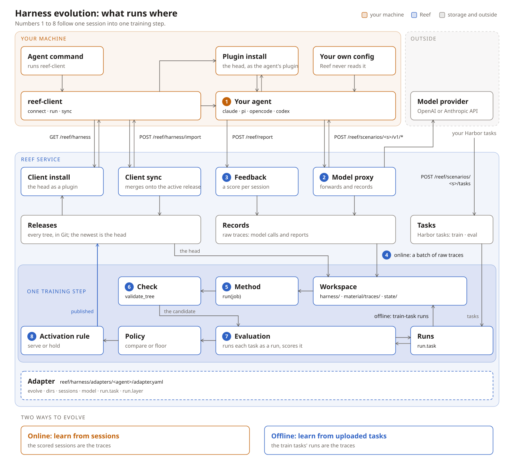

Evolve your harness
===================

Improve an agent's rules, skills, commands and tools while keeping model weights
fixed. Reef evaluates proposed changes and synchronizes active trees to clients.
You need a tool-capable model endpoint, not local training GPUs.

Quickstart
----------

Follow the `pi tutorial <../getting-started/harness-tutorial.rst>`__ for installation,
endpoint setup and feedback. To run its automated example from a checkout:

.. code:: bash

   export REEF_UPSTREAM_API_KEY=sk-...
   cd tutorials/evolve-your-harness && ./run.sh

Set the endpoint, model and token in ``configs/serve.yaml`` first.
The example grades three exact-answer tasks. Each reply starts an evolution
step; ties and unchanged candidates keep the current tree.

How it works
------------

Reef joins recorded model calls to scored reports. The method edits its training
start, called the head. Invalid or unchanged trees skip evaluation.
Publication selects candidates; activation decides when they serve.
Clients install the active tree before a session and upload changed files afterward.

Automatic steps need ``pipeline.sample2job.config.job_samples`` scored reports
(default 1). For unscored traffic, use ``reef.samples.traces:InferenceSamples``
as ``pipeline.record2sample.module``. For explicit instructions, use
`manual training <../reference/http-api-training.rst#manual-training>`__.

Offline: learn from uploaded tasks
----------------------------------

Use this configuration to train and evaluate on Harbor tasks:

.. code:: yaml

   recipe:
     config:
       evolution:
         evaluation:
           imported_tasks: true
           scorer: reef.evaluation.harness:VerifierRewardScorer
           policy: compare
   pipeline:
     sample2job:
       module: reef.train.sample2job.traces:TrainTaskJobData
       config: {buffer_size: 4}

`Upload task directories <../reference/http-api-data-upload.rst#create-task-items>`__
with scenario and ``train`` or ``eval`` assignments. Upload evaluation tasks first;
the first train task can start a run. Each train task runs once, in upload order.

Task directories require Docker, the ``local`` executor and an adapter installed
through npm, uv or git. Use glibc images and ``collect_failures: false``.
Set ``evolution.evaluation.agent_host`` so containers reach Reef; Linux needs
host-gateway configuration for the default ``host.docker.internal``.

Evaluation: the publication policy
----------------------------------

Set ``recipe.config.evolution.evaluation.policy``:

.. list-table::
   :header-rows: 1

   * - Policy
     - Publish when
   * - ``compare``
     - The candidate beats the current tree by more than ``min_margin``. Ties keep the current tree.
   * - ``floor``
     - Every task has a completed run, and every completed run reaches ``floor_score``.
   * - ``none``
     - The candidate is valid. No evaluation tasks or scorer are needed.

With ``compare``, Reef pairs the candidate and current harness by task and repeat.
The default ``wins`` counts wins and losses. The ``mean`` option compares both means on pairs with two scores.
Reef drops a pair if either run failed and rejects the candidate if no complete pair remains.
Completed runs without answers score 0. The mean comparison reports the numbers of complete and dropped pairs.

See `harness configuration <../reference/configuration-harness.rst>`__ for task
sources and executors. The default ``local`` executor provides no isolation.

Use a published tree
--------------------

Connect the agent configured by ``evolution.adapter``:

.. code:: bash

   reef-client harness connect --reef http://127.0.0.1:8901
   reef-client harness status

``connect`` asks for a scenario and token when needed. It installs the active
tree and wraps the agent command. Supported agents are Claude Code, pi,
OpenCode and Codex.

Use ``reef-client harness sync`` to merge changes or ``disconnect`` to remove
the installation. ``sync --discard`` drops local edits. See the tutorial for
`conflicts <../getting-started/harness-tutorial.rst#when-you-and-reef-change-the-same-file>`__.

Activate an inactive artifact
~~~~~~~~~~~~~~~~~~~~~~~~~~~~~

Tree code runs with your privileges. Set ``activation.module: never`` to review
new artifacts before `activating them <operate.rst#set-what-a-scenario-serves>`__.
Inactive artifacts can still become training starts.

Read ``GET /reef/harness/artifacts`` for patches, scores and
`step pages <../reference/http-api-harness.rst#version-page>`__.
``evolution.state_dir`` retains runs and client traffic without pruning; protect it.

Choose or write a method
------------------------

`Choose a recipe <recipes.rst>`__ compares methods. For extensions, read
`Write a harness method <../developer-guide/write-a-harness-method.rst>`__ or
`Harness adapters <../developer-guide/harness-adapters.rst>`__.
