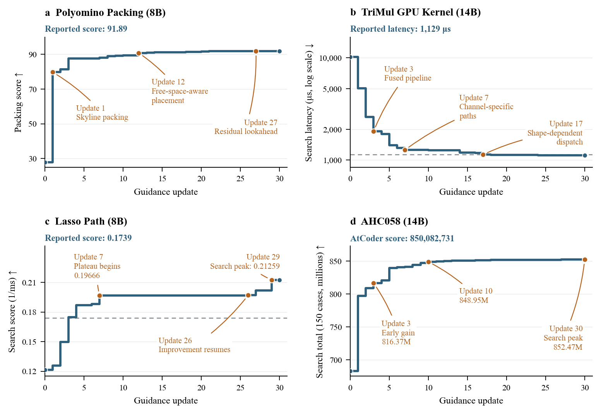

Guidance-TTT: train the guide, keep the executor frozen
=======================================================

Train a small guidance model while a frozen executor writes candidate
programs. A task judge scores each program, and only the guidance response
contributes training tokens. The loop uses the
`TTT-Discover recipe <tttd.rst>`__ with four discovery tasks.

Choose a task
-------------

.. list-table::
   :header-rows: 1

   * - ``GUIDANCE_TASK``
     - Candidate
     - Judge and metric
   * - ``polyomino_packing``
     - C++17 program
     - FrontierCS problem 0, 70 cases, packing score increases
   * - ``lasso_path``
     - Python wrapper containing C++17 ``CPP_CODE``
     - SimpleTES, 17 cases, inverse geometric-mean solve time increases
   * - ``ahc058``
     - C++20 program
     - TTT-Discover's 150 public cases, mean raw score increases
   * - ``trimul``
     - Python module with Triton kernels
     - 18 correctness tests and seven H100 timing cases, latency decreases

Each task uses its own scenario and state directory.

Run an example
--------------

Use Linux, Docker, and the `Reef GPU environment
<../../getting-started/installation.rst>`__. From the repository root:

.. code-block:: shell

   git submodule update --init third_party/reef-client
   uv pip install -e ./third_party/reef-client
   uv pip install -e . -e recipes/tttd/examples/guidance_ttt
   cd recipes/tttd/examples/guidance_ttt

Select a task and prepare its pinned bootstrap:

.. code-block:: shell

   export GUIDANCE_TASK=lasso_path
   python prepare.py "$GUIDANCE_TASK"

Start its judge using the
`evaluator instructions <../../../recipes/tttd/examples/guidance_ttt/judges/README.md>`__.
Set both judge addresses if you change the default port or host:

.. code-block:: shell

   export GUIDANCE_JUDGE_URL=http://127.0.0.1:8082
   export GUIDANCE_JUDGE_CONTAINER_URL=http://host.docker.internal:8082

The host harness uses the first address; Docker's final verifier uses the
second. Polyomino defaults to port 8081; other tasks use 8082.

Choose a separately served GPT-OSS-120B executor:

.. code-block:: shell

   export GUIDANCE_EXECUTOR=local
   export GUIDANCE_EXECUTOR_URL=http://127.0.0.1:8000/v1

Or choose GLM-5.2 through OpenRouter and supply ``OPENROUTER_API_KEY``:

.. code-block:: shell

   export GUIDANCE_EXECUTOR=openrouter

For a bounded smoke run, set ``GUIDANCE_EXECUTOR_MAX_TOKENS=16384``.
Without this setting, the executor provider selects its default output limit.

Start the example from an allocation of four GPUs: two train the LoRA actor
and two serve the guidance model. ``run.sh`` selects GPUs ``0,1,2,3`` unless
``CUDA_VISIBLE_DEVICES`` is set.

.. code-block:: shell

   ./run.sh

The default runs one update with two groups of four rollouts.
It downloads Qwen3-8B, verifies the bootstrap, runs the search, and verifies
the best program. The final Harbor reward is evaluation-only.
This smoke run does not reproduce the paper's budget or executor.

How one step runs
-----------------

1. Select archived parents with PUCT.
2. Ask the guidance model for an improvement, using the problem, parent
   summary, and score.
3. Give the frozen executor the parent code and the guidance.
4. Judge the returned program and report its reward against the guidance receipt.
5. Train the guidance adapter and commit the matching archive.

The guidance model sees the parent's summary, not its source code.
Each response must end with one nonempty ``<guidance>`` block.
Malformed guidance gets zero reward without resampling or an executor call.

The executor returns a complete program and a replacement summary.
The archive ranks valid programs by their raw metric. Training uses a
nonnegative reward; TriMul uses ``1500 / latency_us``.

Configure a search
------------------

``serve.yaml`` owns the grid and training limits. The harness reads the same
file, including a file selected through ``GUIDANCE_CONFIG``.

.. list-table::
   :header-rows: 1

   * - Configuration
     - Default
     - Meaning
   * - ``pipeline.record2sample.config.groups_per_step``
     - 2
     - Parents selected per update
   * - ``pipeline.record2sample.config.rollouts_per_group``
     - 4
     - Guidance samples per parent
   * - ``pipeline.sample2job.config.job_samples``
     - 8
     - Must equal groups times rollouts
   * - ``training.options.global-batch-size``
     - 8
     - Must equal groups times rollouts
   * - ``training.config.steps``
     - 1
     - Total committed updates requested
   * - ``training.config.max_tokens``
     - 8192
     - Maximum guidance response length
   * - ``GUIDANCE_MAX_WORKERS``
     - 8
     - Concurrent executor calls
   * - ``GUIDANCE_MODEL``
     - ``Qwen/Qwen3-8B``
     - Guidance model downloaded by the launcher
   * - ``GUIDANCE_STATE_DIR``
     - ``work/<task>``
     - Absolute root for records, checkpoints, and the archive

For the paper budget, set the grid to 8 by 16, ``job_samples`` and the batch size to 128,
and the update count to 30. AHC058 and TriMul use Qwen3-14B in the main results.
Set ``GUIDANCE_MODEL=Qwen/Qwen3-14B`` for those configurations. Model size,
context length, and concurrency determine the required GPU memory.

Bootstrap verification uses the same evaluator as search. For your own seed,
set ``GUIDANCE_SEED`` to its source file. Place a canonical summary beside it
with the same stem and a ``.md`` extension.

The report contract
-------------------

Each report references the receipt from its guidance inference. Its metadata
contains ``step``, ``group``, ``rollout``, ``groups_per_step``, and
``rollouts_per_group``. The
`TTT-Discover guide <tttd.rst>`__ describes the complete grid contract.

The task judge returns ``score`` for training and ``scoreUnbounded`` for
archive ranking. It also returns ``valid``. An invalid AHC058 program can earn
a partial training reward, but it cannot enter the executable archive.

A missing judge, malformed score, or executor service error stops the step.
These errors do not become zero-reward training examples. A rejected candidate
receives the task's invalid reward and still counts as a PUCT visit.

Paper results
-------------

These historical results are from commit ``709c405``, with a frozen GLM-5.2
executor and 30 updates of eight groups of 16 rollouts. They are not new
measurements of the current example.

.. list-table::
   :header-rows: 1

   * - Task
     - Guidance model
     - Reported result
     - Evaluation
   * - Polyomino Packing
     - Qwen3-8B
     - **91.89**
     - 70-case packing score, higher is better
   * - Lasso Path
     - Qwen3-8B
     - **0.1739**
     - Inverse geometric-mean solve time, higher is better
   * - AHC058
     - Qwen3-14B
     - **850,082,731**
     - Submitted solution's AtCoder score, higher is better
   * - TriMul
     - Qwen3-14B
     - **1,129 microseconds**
     - Seven-case H100 geometric-mean latency, lower is better

The curves show best archived solutions, which can use a different protocol
from final evaluation. Lasso peaks near 0.21259 during search; its final
frozen-solver score is 0.1739. AHC058 reports an AtCoder submission score
rather than its 150-case search score. TriMul reports fixed-kernel timing.

The `result records <../../../recipes/tttd/examples/guidance_ttt/results/paper/README.md>`__
hold the baseline values, source checksums, and numerical histories. The
baselines use the models and budgets of their source experiments, so they are
not controlled comparisons. TriMul's 1,129 microseconds does not beat the
eligible GPUMode rank-1 reference of 1,128.

Inspect progress and resume
---------------------------

Inspect ``reef.log`` and ``guidance-run/`` under the task's state directory.
The controller waits for each training job and checks its checkpoint metrics
before committing the corresponding archive.

Restart with the same task, model, executor, grid, configuration, and state
directory. Reef restores ``committed-library.json`` and checks the stored
identity. Use a new directory after changing the task contract or executor.

The example saves a checkpoint after each version. A saved program alone
cannot restore the optimizer; retain both training checkpoints and archive.

Enable experiment tracking
--------------------------

Enable ``observability.wandb.enabled`` in ``serve.yaml`` and set the project
and credentials. See `Track experiments with W&B
<../operate.rst#track-experiments-with-w-b>`__.

The ``tttd/*`` metrics describe training rewards. Use the committed archive's
raw score to track the best program, especially with normalized rewards.

Add another task
----------------

Add a directory under ``harbor/`` with an instruction, contract, bootstrap
source, environment, and final verifier. Register its name and timeout in
``harness/config.py``. Implement a judge that returns a finite training reward,
the raw metric, and candidate validity. Add contract and invalid-output tests
before a GPU run.

Related guides
--------------

* `TTT-Discover <tttd.rst>`__: the grouped objective and training transaction.
* `Train model weights <../evolve-your-model.rst>`__: the GPU runtime.
* `Example README <../../../recipes/tttd/examples/guidance_ttt/README.md>`__: evaluator setup and local checks.
