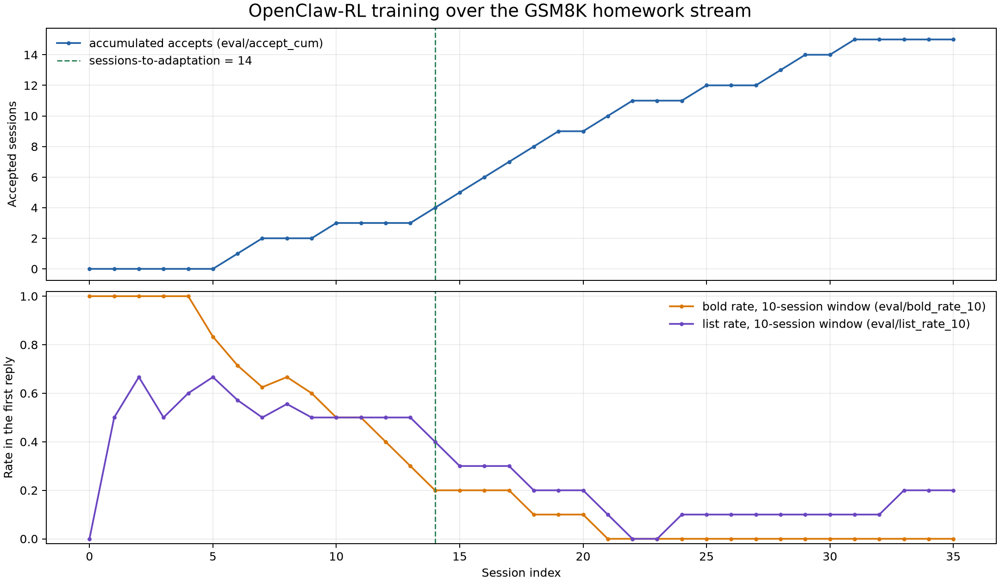

OpenClaw-RL: learn from agent conversations
===========================================

OpenClaw-RL (`arXiv:2603.10165 <https://arxiv.org/abs/2603.10165>`__) trains
a personal agent to satisfy the preferences of its user. It learns from their
conversations: the user's next message shows whether a reply was accepted,
and the model is updated while the agent stays in service.

+-------------+------------------------------------------------------------+
| Evolves     | model weights                                              |
+-------------+------------------------------------------------------------+
| Signal      | none sent by the agent; Reef reads its recorded traffic    |
+-------------+------------------------------------------------------------+
| Loss family | ``openclawrl``                                             |
+-------------+------------------------------------------------------------+
| Package     | ``recipes/openclawrl/``                                    |
+-------------+------------------------------------------------------------+
| Pipeline    | computed feedback                                          |
+-------------+------------------------------------------------------------+
| Needs       | GPUs, plus a second served model for the PRM judge         |
+-------------+------------------------------------------------------------+
| Example     | ``recipes/openclawrl/examples/openclawrl/``                |
+-------------+------------------------------------------------------------+

How it works
------------

The learning signal comes from the conversation itself. When the user accepts
a reply and moves on, the turn counts as positive. When the user complains,
it counts as negative. Reef reads this from the traffic it already records,
so the agent sends no training reports.

.. container:: flow

   Traffic
       requests and responses recorded by Reef

   Sessions
       turns correlated by session tag, with trace matching as a fallback

   **Judge**
       score each turn from the state that followed it

   Step
       train the policy on judged turns

   :Loop: the next session is served by the updated weights

Correlate sessions
~~~~~~~~~~~~~~~~~~

The judging stage rebuilds sessions from the recorded traffic. Send a stable
``x-reef-tag-session`` header on every inference of a conversation. The value
must be unique to the conversation within its scenario: Reef binds the turns
of one tag in arrival order, so concurrent or distinct conversations must not
share a tag. The tag also supports agents that keep or rewrite their history
locally. Hermes cannot set the tag itself, so the included example uses a
small header shim.

Without the tag, the stage falls back to trace matching: the client must
resend an extending transcript on each request. The fallback has limits:

- Identical histories can be ambiguous.
- A history change that does not preserve a prefix, such as compaction or a
  sliding window, breaks the chain and leaves the earlier turn unmatched.
- A turn that never correlates is never judged and never trains, so a run on
  the fallback can produce an empty training set.

The recipe warns once when it sees untagged traffic, and again when sessions
keep expiring without a bound turn. It counts both under ``correlation`` in
the ``prm_record_file`` line. ``max_open_sessions`` caps the session table
and evicts the least recently active sessions above it.

Judge and train
~~~~~~~~~~~~~~~

When a session's next state arrives, an independently deployed PRM judges the
finished turn. The PRM votes on whether the next message shows acceptance. On
acceptance, it also proposes a hindsight hint: a short instruction that would
have produced this reply if the user had given it first. Judged turns go
directly into job data.

OpenClaw-RL trains with two signals:

- **RL.** A PPO clipped surrogate on the sampled tokens, with the turn's raw
  reward as its advantage. ``--openclawrl-w-rl`` sets its weight (default
  1.0).
- **On-policy distillation (OPD).** The policy is pulled toward a teacher on
  the student's top-K token candidates. The teacher is the frozen base model
  conditioned on one accepted hindsight hint; the objective selects the hint
  whose teacher top-K best overlaps the policy's. ``--openclawrl-topk`` sets K
  (default 4) and ``--openclawrl-w-opd`` sets the weight (default 1.0).

Set these flags in ``training.options``. The actor computes the top-K
candidates and their old-policy log-probabilities with the weights of the
step's start.

The training component renders the judged turn, and one hint-enhanced teacher
request for each candidate hint, with the model's chat template. Give the
component the serving engine's chat template arguments (`Chat template
arguments <../../reference/configuration-inference.rst#chat-template-arguments>`__). A
turn that cannot render, or whose candidates all fail to render, does not
train, and the job metric ``unrenderable_samples`` counts it.

Configuration
-------------

The deployment's ``pipeline`` section configures the recipe's two stages. The
recipe's own classes are the defaults, so the section needs no ``module``.

- ``record2sample`` (``OpenClawRLSamples``) correlates sessions, runs the PRM
  judge, and makes one sample of each judged turn.
- ``sample2job`` sets the job size and writes the PRM record file.

.. code:: yaml

   recipe:
     implementation: recipes.openclawrl.recipe:OpenClawRLRecipe
   pipeline:
     record2sample:
       config:
         prm_url: http://127.0.0.1:23001
         prm_tokenizer_path: /models/prm
     sample2job:
       config:
         job_samples: ${training.config.global_batch_size}
   training:
     config:
       global_batch_size: 16

.. container:: config

   ``pipeline.record2sample.config.session_ttl_s`` : 900.0
       idle time in seconds before a session expires

   ``pipeline.record2sample.config.max_open_sessions`` : 4096
       ceiling on live sessions; the least recently active are evicted above it

   ``pipeline.record2sample.config.prm_url`` : ""
       the PRM's SGLang server. Empty is correlate-only mode: nothing is judged and nothing trains.

   ``pipeline.record2sample.config.prm_tokenizer_path`` : ""
       the PRM's tokenizer. Required when ``prm_url`` is set.

   ``pipeline.record2sample.config.prm_m`` : 3
       judge votes per turn

   ``pipeline.record2sample.config.prm_temperature`` : 0.6
       judge sampling temperature

   ``pipeline.record2sample.config.prm_max_tokens`` : 8192
       judge generation budget

   ``pipeline.record2sample.config.prm_timeout_s`` : 120.0
       per-judge timeout in seconds

   ``pipeline.record2sample.config.prm_concurrency`` : 8
       turns judged at once

   ``pipeline.record2sample.config.prm_max_hint_candidates`` : 3
       hint candidates collected per turn

   ``pipeline.sample2job.config.job_samples`` : required
       judged turns per job. Set it to ``training.config.global_batch_size`` so that one job is one optimizer step.

   ``training.config.global_batch_size``
       judged turns per optimizer step. Reef passes it to Slime as ``--global-batch-size``.

   ``pipeline.sample2job.config.prm_record_file`` : ""
       judged population, one JSON line per job; empty disables it

Reef checks the stage config when it loads the recipe. An unknown key or an
invalid value stops the deployment at startup. A stage key in
``recipe.config``, such as ``prm_url``, also stops it, and the error names the
key's ``pipeline`` path.

The example's ``serve.yaml`` overrides several defaults:

- ``prm_url`` and ``prm_tokenizer_path`` point at the example's PRM engine.
- ``prm_timeout_s`` is 3600, because a thinking model can spend minutes on a
  single vote.
- ``prm_record_file`` is set, so each job writes one line with its
  ``data_id``, the reward split, and the judge counters.

Reef does not register, schedule or stop the PRM process. The example's
Compose file owns PRM and student-model startup, health checks and GPU
allocation. The simulation harness uses the student-model endpoint, outside
Reef.

Run the example
---------------

The `example <../../../recipes/openclawrl/examples/openclawrl>`__ reproduces
the paper's personal-agent experiment. A simulated student brings 72 GSM8K
homework problems to a Hermes agent with one session per problem. Each
session is scored on whether the agent's first solution reply satisfies the
student's preferences.

.. code:: bash

   docker build -f docker/Dockerfile.reef -t reef-openclawrl .
   hf download Qwen/Qwen3-4B-Thinking-2507 --local-dir ~/models/Qwen3-4B-Thinking-2507   # policy and PRM
   hf download Qwen/Qwen3-32B --local-dir ~/models/Qwen3-32B                             # the student

   bash recipes/openclawrl/examples/openclawrl/run.sh

``run.sh`` builds the simulated student's image, starts the stack that
``serve.yaml`` describes, and runs the 72 sessions in order. The stack
uses seven GPUs: four for the tensor-parallel actor, one for the rollout
engine, one for the PRM, and one for the Qwen3-32B student model.

Results
-------

The example's README records one run over the first 36 sessions of the stream.

A session passes when the agent's first solution reply already matches the
student's preferences, with the work shown and the correct answer. The
student wants homework that does not look AI-written, so a reply that uses
bold text or a list draws a complaint. The bold rate and the list rate are
the fractions of the last ten sessions whose first reply still contains bold
text or a list. Both fall as training goes on. The run reaches the paper's
adaptation criterion, three passed sessions in a row, at session 14.

.. image:: ../../assets/openclawrl/demo.gif
   :alt: A failing and a passing session replayed from the run, with the student's ask, the agent's reply, and the student's reaction

The demo replays two sessions from the same run. In session 1 the student
rejects a formatted reply. By session 16 the first reply passes directly.

Related guides
--------------

- `Inference and feedback quickstart <../../getting-started/quickstart.rst>`__:
  learn the request, receipt, and report workflow.
- `Train model weights from agent feedback <../evolve-your-model.rst>`__:
  set up the GPU stack and inspect published updates.
- `HTTP API reference <../../reference/http-api.rst>`__: connect your agent
  and query feedback, scenarios, and artifacts.
