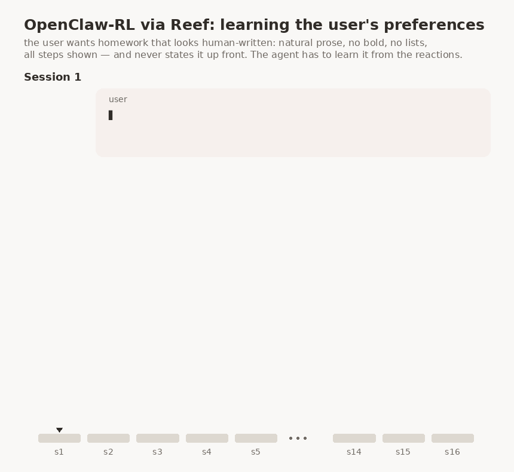

OpenClaw-RL: learn from agent conversations
===========================================

Use `OpenClaw-RL <https://arxiv.org/abs/2603.10165>`__ to train an agent from
its conversations. A judge reads the user's next message as feedback on the
previous reply. Reef updates the weights while the agent stays in service.
The recipe requires Slime, GPUs, and a separately served judge model.

Run the example
---------------

The `homework example
<../../../recipes/openclawrl/examples/openclawrl/README.md>`__ runs 72 GSM8K
sessions with a Hermes agent and a simulated student. It requires Docker
and seven GPUs: four for training, and one each for serving, the PRM,
and the student model.

.. code:: bash

   docker build -f docker/Dockerfile.reef -t reef-openclawrl .
   hf download Qwen/Qwen3-4B-Thinking-2507 --local-dir ~/models/Qwen3-4B-Thinking-2507
   hf download Qwen/Qwen3-32B --local-dir ~/models/Qwen3-32B
   bash recipes/openclawrl/examples/openclawrl/run.sh

``run.sh`` builds the simulated student's image, starts the stack, and runs
the sessions in order. The agent sends no training reports.

How it works
------------

Reef groups recorded calls into sessions. When a session's next state
arrives, a separate process reward model (PRM) judges the previous turn.
The judge scores acceptance and can propose hindsight hints.

Correlate sessions
~~~~~~~~~~~~~~~~~

Send a stable ``x-reef-tag-session`` header on every call in a conversation.
The value must be unique within the scenario. Reef orders matching turns by
arrival, so concurrent conversations must not share a tag. The example adds
this header through a shim for Hermes.

Without a tag, Reef matches extending transcripts. Identical histories can
be ambiguous; compaction and sliding windows can break the chain.
An unmatched turn never trains. Reef warns about untagged traffic and
sessions that expire without a match. The ``correlation`` counters appear
in the ``prm_record_file`` output.

Judge and train
~~~~~~~~~~~~~~~

The objective combines two signals:

- RL uses a PPO clipped surrogate with the judged reward as its advantage.
  ``openclawrl-w-rl`` sets the weight; default 1.0.
- Distillation uses a frozen base model conditioned on an accepted hindsight
  hint. ``openclawrl-w-opd`` sets its weight; default 1.0.
  ``openclawrl-topk`` sets the candidate token count; default 4.

Set these flags in ``training.options``. Match training and serving
`chat template arguments
<../../reference/configuration-inference.rst#chat-template-arguments>`__.
A turn that cannot render does not train. The same applies when no hint
candidate renders. ``unrenderable_samples`` counts these exclusions.

Configuration
-------------

Set the PRM endpoint and tokenizer under ``pipeline.record2sample``.
Set the number of judged turns per job under ``pipeline.sample2job``.

.. code:: yaml

   recipe:
     implementation: recipes.openclawrl.recipe:OpenClawRLRecipe
   pipeline:
     record2sample:
       config:
         prm_url: http://127.0.0.1:23001
         prm_tokenizer_path: /models/prm
     sample2job:
       config:
         job_samples: ${training.config.global_batch_size}
   training:
     config:
       global_batch_size: 16

.. container:: config

   ``pipeline.record2sample.config.session_ttl_s`` : 900.0
       idle time in seconds before a session expires

   ``pipeline.record2sample.config.max_open_sessions`` : 4096
       Maximum live sessions. Reef evicts the least recently active sessions.

   ``pipeline.record2sample.config.prm_url`` : ""
       the PRM's SGLang server. Empty is correlate-only mode: nothing is judged and nothing trains.

   ``pipeline.record2sample.config.prm_tokenizer_path`` : ""
       the PRM's tokenizer. Required when ``prm_url`` is set.

   ``pipeline.record2sample.config.prm_m`` : 3
       judge votes per turn

   ``pipeline.record2sample.config.prm_temperature`` : 0.6
       judge sampling temperature

   ``pipeline.record2sample.config.prm_max_tokens`` : 8192
       judge generation budget

   ``pipeline.record2sample.config.prm_timeout_s`` : 120.0
       per-judge timeout in seconds

   ``pipeline.record2sample.config.prm_concurrency`` : 8
       turns judged at once

   ``pipeline.record2sample.config.prm_max_hint_candidates`` : 3
       hint candidates collected per turn

   ``pipeline.sample2job.config.job_samples`` : required
       Judged turns per job. Match ``training.config.global_batch_size`` for
       one optimizer step per job.

   ``training.config.global_batch_size``
       judged turns per optimizer step. Reef passes it to Slime as ``--global-batch-size``.

   ``pipeline.sample2job.config.prm_record_file`` : ""
       judged population, one JSON line per job; empty disables it

Unknown keys and invalid values stop startup. Stage settings such as
``prm_url`` must be under ``pipeline``, not ``recipe.config``.

The example sets ``prm_timeout_s`` to 3600 for its thinking model.
It also sets ``prm_record_file`` to save each job's reward split and judge
counters. Reef does not manage the PRM process. The example's Compose file
starts the PRM and simulated-student models.

Results
-------

The example records one run over the first 36 sessions. A session passes
when the first solution is correct, shows its work, and matches the student's
formatting preferences.

.. image:: ../../assets/openclawrl/learning-curve.png
   :alt: Accumulated accepts and rolling bold and list rates

The bold and list rates fall during training. The run reaches three passed
sessions in a row at session 14. This is one run, not a multi-seed estimate.

The replay shows a rejected reply from session 1 and an accepted first reply
from session 16.

Related guides
--------------

- `Inference and feedback quickstart <../../getting-started/quickstart.rst>`__:
  learn the request, receipt, and report workflow.
- `Train model weights from agent feedback <../evolve-your-model.rst>`__:
  set up the GPU stack and inspect published updates.
- `HTTP API reference <../../reference/http-api.rst>`__: connect your agent
  and query feedback, scenarios, and artifacts.
