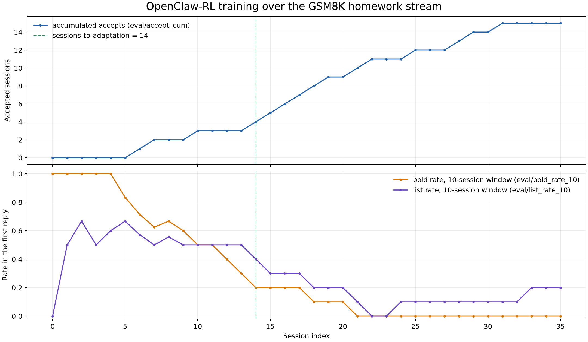
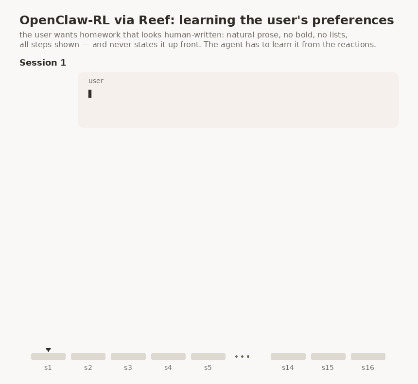

OpenClaw-RL: learn from agent conversations
===========================================

OpenClaw-RL (`arXiv:2603.10165 <https://arxiv.org/abs/2603.10165>`__) trains
a personal agent to satisfy the preferences of its user. It learns from their
conversations: the user's next message shows whether a reply was accepted,
and the model is updated while the agent stays in service.

+-------------+------------------------------------------------------------+
| Evolves     | model weights                                              |
+-------------+------------------------------------------------------------+
| Signal      | none sent by the agent; Reef reads its recorded traffic    |
+-------------+------------------------------------------------------------+
| Loss family | ``openclawrl``                                             |
+-------------+------------------------------------------------------------+
| Package     | ``recipes/openclawrl/``                                    |
+-------------+------------------------------------------------------------+
| Pipeline    | computed feedback                                          |
+-------------+------------------------------------------------------------+
| Needs       | GPUs or one Apple Silicon Mac, plus a separate PRM judge   |
+-------------+------------------------------------------------------------+
| Example     | ``recipes/openclawrl/examples/openclawrl/``                |
+-------------+------------------------------------------------------------+

What it does
------------

The learning signal comes from the conversation itself: when the user
accepts a reply and moves on, the turn counts as positive, and when the user complains, it counts as
negative. Reef reads this from the traffic it already records, so the agent
does not send training reports. For reliable correlation, the harness should
send a stable ``x-reef-tag-session`` value, unique to the conversation within
its scenario, on every inference in that conversation. Reef stores this opaque
tag with each record and the judging stage uses it to bind turns in arrival order,
so one tag must not be shared by concurrent or distinct conversations. Without
the tag, the judging stage falls back to matching the transcripts that clients
resend on later requests.

.. flow::
   :loop: the next session is served by the updated weights

   Traffic :: requests and responses recorded by Reef
   Sessions :: turns correlated by session tag, with trace matching as a fallback
   Judge* :: score each turn from the state that followed it
   Step :: train the policy on judged turns

How Reef implements it
----------------------

The judging stage rebuilds sessions from the recorded traffic. It prefers the
``x-reef-tag-session`` value supplied by the harness, which also supports
agents that keep or rewrite their history locally. If the tag is absent, a
chat agent must resend an extending transcript so each request can be matched
to its session by trace. Identical histories can be ambiguous, while history
changes that no longer preserve a prefix, such as compaction or sliding
windows, break the chain and leave the pre-rewrite turn unmatched. The
included Hermes example uses a small header shim because Hermes cannot set the
tag itself.

A turn that never correlates is never judged and never trains, so a run on the
fallback can produce an empty training set with nothing else to show for it.
The recipe therefore says so: it warns once when it sees untagged traffic,
warns again when sessions keep expiring without ever binding a turn, and counts
both under ``correlation`` in the ``prm_record_file`` line. ``max_open_sessions``
caps the table those unmatched requests fill, evicting the least recently active
sessions above it.

When a session's next state arrives, the finished turn is judged
through an independently deployed PRM. The PRM votes on
whether the message shows acceptance, and on acceptance it also proposes a
hindsight hint, a short instruction that would have produced this reply if
the user had given it up front. Judged turns are batched for training
directly.

OpenClaw-RL trains with two signals, reinforcement learning and on-policy
distillation (OPD). The RL term is a PPO clipped surrogate on the sampled
tokens, with the turn's raw reward as its advantage. The OPD term pulls the policy toward a teacher on the top-K token
candidates the engine recorded at generation time. The teacher is the frozen
base model conditioned on one of the accepted hindsight hints, and the
objective selects which hint by how well the teacher's top-K overlaps the
policy's. The weights of the two terms are ``--openclawrl-w-rl`` and
``--openclawrl-w-opd`` in ``training.options``, both 1.0 by default.

Configuration
-------------

The deployment's ``pipeline`` section configures the recipe's three stages.
The recipe's own classes are the defaults, so the section needs no
``module``. The record-to-record stage correlates sessions and runs the PRM
judge. The task-to-batch stage sets the batch size and writes the PRM record
file. The record-to-task stage takes no config.

.. code:: yaml

   recipe:
     implementation: recipes.openclawrl.recipe:OpenClawRLRecipe
   pipeline:
     record2record:
       config:
         prm_url: http://127.0.0.1:23001
         prm_tokenizer_path: /models/prm
     task2batch:
       config:
         batch_size: 16

.. config::

   pipeline.record2record.config.session_ttl_s | 900.0 | idle time in seconds before a session expires
   pipeline.record2record.config.max_open_sessions | 4096 | ceiling on live sessions; the least recently active are evicted above it
   pipeline.record2record.config.prm_api | sglang | how Reef calls the judge: ``sglang`` posts to a served PRM's native ``/generate``; ``openai`` posts chat messages to an OpenAI-compatible ``/chat/completions``
   pipeline.record2record.config.prm_url | "" | the judge endpoint: the server base URL for ``sglang``, the full ``/chat/completions`` URL for ``openai``. Empty is correlate-only mode: nothing is judged and nothing trains.
   pipeline.record2record.config.prm_tokenizer_path | "" | the PRM's tokenizer, used by the teacher, the response renderer and an ``sglang`` judge. Required when ``prm_url`` is set.
   pipeline.record2record.config.prm_model | "" | the provider model name. Required when ``prm_api`` is ``openai``.
   pipeline.record2record.config.prm_api_key_env | "" | the name of the environment variable that holds the provider credential. Only for ``prm_api: openai``.
   pipeline.record2record.config.prm_m | 3 | judge votes per turn
   pipeline.record2record.config.prm_temperature | 0.6 | judge sampling temperature
   pipeline.record2record.config.prm_max_tokens | 8192 | judge generation budget
   pipeline.record2record.config.prm_timeout_s | 120.0 | per-judge timeout in seconds
   pipeline.record2record.config.prm_concurrency | 8 | turns judged at once
   pipeline.record2record.config.prm_max_hint_candidates | 3 | hint candidates collected per turn
   pipeline.record2record.config.teacher_chat_template_kwargs | {} | chat-template arguments of the teacher's hint-enhanced prompt; set the policy's own (``training.options.chat_template_kwargs`` on MLX), so the teacher's prompt ends where the policy's did
   pipeline.record2record.config.tool_turn_reward | prm | the reward of a turn whose next state is a tool result: ``prm`` asks the PRM, as upstream does; ``neutral`` gives no reward, so the turn trains only from an accepted hint; ``skip`` does not judge or train the turn
   pipeline.record2record.config.negative_reward | prm | the reward of a turn that the PRM scores -1: ``prm`` keeps -1, as upstream does; ``neutral`` gives no reward, so the turn trains only from an accepted hint
   pipeline.task2batch.config.batch_size | 16 | judged turns per training step. Must equal the driver's ``--global-batch-size``.
   pipeline.task2batch.config.prm_record_file | "" | judged population, one JSON line per batch; empty disables it
   recipe.config.max_staleness | 0 | accepted lag between the producing and serving version. Env ``REEF_MAX_STALENESS``.

The upstream judge prompt scores any tool output without an error as +1. A
policy can then earn reward with tool calls that do nothing for the user. In
the MLX GSM8K stream, the PRM scored 28 of 34 such calls +1, such as a
background ``terminal`` command or a deleted homework file. It scored 7 of 20
text replies +1. After about 20 steps, the policy stopped replying in text.
``tool_turn_reward: neutral`` removes that reward. Only the student's reaction
then rewards or penalizes a turn.

Most student reactions then reject the reply's style, so most rewards are -1.
A -1 lowers the probability of the whole reply, and the policy can lower it by
calling a tool instead of replying in text. In the same stream, one step on
five rejected replies cut the text answers of a fixed probe from 16 of 24 to 8
of 24. One step on the same turns with no reward, trained only from their
hints, did not. ``negative_reward: neutral`` gives a rejected turn no reward,
so the hint teaches the correction and the reward term keeps only +1.

At learning rate 1e-4, four steps from the base adapter moved the reply style
about 40% toward plain text. Trained on all judged turns, the same steps also
stopped the policy from answering in text: 0 of 8 probe conversations. Trained
on the turns the student judged, it kept 8 of 8. One step on tool turns alone
reached a loss of 4211. ``tool_turn_reward: skip`` leaves tool turns out of
training.

With ``prm_api: openai``, a hosted provider can be the judge, because the
judge needs only generated text. The config holds the name of the credential
variable, not the credential. The judging stage fails to start when the
named variable is not set. ``prm_tokenizer_path`` is still required: the
teacher and the response renderer use the local tokenizer.

Reef checks the stage config when it loads the recipe. An unknown key or an
invalid value stops the deployment at startup. A stage key in
``recipe.config``, such as ``prm_url``, also stops it, and the error names the
key's ``pipeline`` path.

The values above are the defaults. The example's ``serve.yaml`` overrides
several of them. It points ``prm_url`` and ``prm_tokenizer_path`` at the
example's independently deployed PRM engine. It raises ``prm_timeout_s`` to
3600 because a thinking model can spend minutes on a single vote. It sets
``prm_record_file``, so each batch writes one line with its ``batch_id``, the
reward split, and the judge counters.

Reef coordinates inference and training only. OpenClawRL's example Compose
file owns PRM and student-model startup, health checks and GPU allocation.
The judging stage consumes ``pipeline.record2record.config.prm_url`` and
requires the matching ``prm_tokenizer_path``; it owns judge request handling.
Reef does not register, schedule or stop the PRM process. The student-model
endpoint is used by the simulation harness, outside Reef.

Run the example
---------------

The `example <../../../recipes/openclawrl/examples/openclawrl>`__ reproduces
the paper's personal-agent experiment. A simulated student brings 72 GSM8K
homework problems to a Hermes agent with one session per problem. Each
session is scored on whether the agent's first solution reply satisfies the
student's preferences.

.. code:: bash

   docker build -f docker/Dockerfile.reef -t reef-openclawrl .
   hf download Qwen/Qwen3-4B-Thinking-2507 --local-dir ~/models/Qwen3-4B-Thinking-2507   # policy and PRM
   hf download Qwen/Qwen3-32B --local-dir ~/models/Qwen3-32B                             # the student

   bash recipes/openclawrl/examples/openclawrl/run.sh

``run.sh`` builds the simulated student's image, starts the stack that
``serve.yaml`` describes, and runs the 72 sessions in order. The stack
uses seven GPUs: four for the tensor-parallel actor, one for the rollout
engine, one for the PRM, and one for the Qwen3-32B student model.

Run on Apple Silicon
~~~~~~~~~~~~~~~~~~~~

``serve-mlx.yaml`` in the example directory runs the same stream on one
Apple Silicon Mac. The policy serves and trains in the Reef process on MLX.
The PRM judge and the simulated student are hosted models. Serving is slower
than on GPUs, so raise ``OPENCLAWRL_TURN_TIMEOUT_S`` and keep a long
``session_ttl_s``. See `Train on Apple Silicon with MLX <../mlx.rst>`__ for
the backend and these settings.

Results
-------

The example's README records one run over the first 36 sessions of the stream.

A session passes when the agent's first solution reply already matches the
student's preferences, with the work shown and the correct answer. The
student wants homework that does not look AI-written, so a reply that uses
bold text or a bullet or numbered list draws a complaint. The bold rate and
the list rate measure this habit over the run, as the fraction of the last
ten sessions whose first reply still contains bold text or a list. From the curves we see both fall as
training goes on, and the run reaches the paper's adaptation criterion
(three passed sessions in a row) at session 14.

The demo above replays two sessions from the same run. In session 1 the
student rejects a formatted reply, reef keeps the training going, and by
session 16 the first reply passes directly.

Related guides
--------------

- `Inference and feedback quickstart <../../getting-started/quickstart.rst>`__:
  learn the request, receipt, and report workflow.
- `Train model weights from agent feedback <../evolve-your-model.rst>`__:
  set up the GPU stack and inspect published updates.
- `HTTP API reference <../../reference/http-api.rst>`__: connect your agent
  and query feedback, scenarios, and releases.
