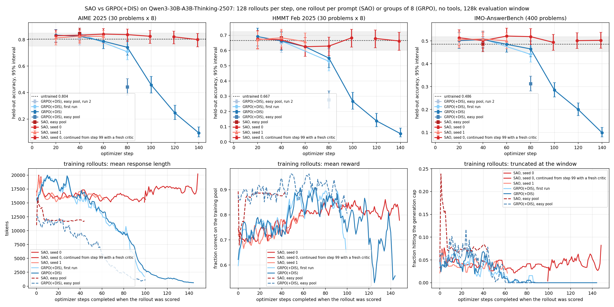

SAO: learn from individual rollouts
===================================

Single-Rollout Asynchronous Optimization (`arXiv:2607.07508
<https://arxiv.org/abs/2607.07508>`__) samples one rollout per prompt and
grades each on its own. A scored rollout joins the next optimizer step
without waiting for siblings, and the next attempt runs on the weights that
step produced.

+-------------+------------------------------------------------------------+
| Evolves     | model weights                                              |
+-------------+------------------------------------------------------------+
| Signal      | one report with a finite ``score`` per rollout             |
+-------------+------------------------------------------------------------+
| Loss family | ``sao``                                                    |
+-------------+------------------------------------------------------------+
| Package     | ``recipes/sao/``                                           |
+-------------+------------------------------------------------------------+
| Pipeline    | reported feedback, singleton                               |
+-------------+------------------------------------------------------------+
| Needs       | GPUs and the Slime training backend                        |
+-------------+------------------------------------------------------------+
| Example     | ``recipes/sao/examples/imo_answerbench/``                  |
+-------------+------------------------------------------------------------+

How it works
------------

SAO has no comparison group. Reef accepts a rollout when its score arrives,
without a barrier. ``job_samples`` accepted rollouts, each from its own
prompt, form one training job. Use SAO for a stream of tasks where each
attempt gets its own score.

.. container:: flow

   Rollout
       one attempt at a task

   Feedback
       a score reported against the rollout's receipt

   **Step**
       train once ``job_samples`` scored rollouts have accumulated

   Version
       publish the updated weights to the engine

   :Loop: the next attempt runs on the updated weights

- **Samples.** The record-to-sample stage, ``SAOSamples``, makes one sample
  from every eligible report with a finite ``score``.
- **Loss.** The ``sao`` loss family runs Slime's ``policy_loss`` with SAO's
  per-token primitive and a critic that shares the actor's GPUs. The critic
  supplies the values, and skip-observation GAE builds the advantages in the
  training backend.
- **Old-policy log-probabilities.** Serving records none. The training
  component renders each rollout with the model's chat template, and the
  actor computes them with the weights of the job's start. The DIS ratio is
  exact for ``max_artifact_lag: 0``. Above 0 it measures the drift within the
  job, not the gap to the weights that sampled the rollout. Give the
  component the serving engine's chat template arguments (`Chat template
  arguments <../../reference/configuration-inference.rst#chat-template-arguments>`__).
- **Value model.** The critic trains at its own, higher learning rate
  (``--critic-lr``). The first ``--num-critic-only-steps`` optimizer steps fit
  the zero-initialized value head before any policy update. These warmup
  steps still commit one training snapshot each; the policy's weights first
  move after the warmup. An MoE value model trains its experts, layer norms,
  and value head while its self-attention stays frozen (paper Section 4). A
  dense value model trains every parameter unless
  ``--sao-freeze-critic-attention`` applies the same freeze.

Configuration
-------------

SAO's pipeline has two stages, ``SAOSamples`` and ``SAOJobData``. The
deployment's ``pipeline`` section configures them. SAO updates asynchronously,
so a rollout may train while the scenario serves a later artifact. Set that
lag bound in the record-to-sample stage, the job size in the sample-to-job
stage, and the optimizer batch in the training config:

.. code:: yaml

   recipe:
     implementation: recipes.sao.recipe:SAORecipe
   pipeline:
     record2sample:
       config:
         max_artifact_lag: 18
     sample2job:
       config:
         job_samples: ${training.config.global_batch_size}
   training:
     config:
       global_batch_size: 8

.. container:: config

   ``pipeline.sample2job.config.job_samples`` : required
       rollouts (one per prompt) per job. Set it to ``training.config.global_batch_size`` so that one job is one optimizer step.

   ``training.config.global_batch_size``
       rollouts (one per prompt) per optimizer step; the paper uses 128. Reef passes it to Slime as ``--global-batch-size``. 1 trains on every rollout as it lands and is a smoke setting only: the value model needs a full optimizer batch per step to learn, and without it the single-sample advantages are noise.

   ``pipeline.record2sample.config.accept_multi_turn_policy_samples`` : false
       true trains every call of a report's trajectory, every reply; false trains only the reply of the trajectory's last call, with the earlier turns as context.

   ``pipeline.record2sample.config.max_artifact_lag`` : 0
       the artifacts that the scenario may have served after the one that sampled a rollout, for the rollout to train; a non-negative int. 0 trains only rollouts of the served artifact. The samples service marks a rollout beyond the bound stale.

A ``batch-size`` key in ``recipe.config`` or in
``pipeline.sample2job.config`` is an unknown key: the recipe or the scenario's
pipeline refuses it.

Run the example
---------------

The `example <../../../recipes/sao/examples/imo_answerbench>`__ runs three IMOAnswerBench
problems in order on a two-GPU stack. For each problem the agent makes six
attempts through Reef, extracts the ``\boxed{}`` answer, then checks it against
the gold answer for a binary reward and finally reports the result against its
receipt. The next problem is served by the weights the previous one produced.

.. code:: bash

   cd recipes/sao/examples/imo_answerbench
   pip install -e .
   hf download Qwen/Qwen2.5-1.5B-Instruct --local-dir ~/models/Qwen2.5-1.5B-Instruct
   ./run.sh

``run.sh`` starts the stack that ``serve.yaml`` describes: one Megatron actor
that shares its GPU with the critic, and one SGLang serving engine. The smoke
config sets ``training.config.global_batch_size`` to 1, so each scored
rollout adds one ``training`` entry to the scenario's version chain:

.. code:: bash

   curl -sS -H "Authorization: Bearer reef-local" \
     http://127.0.0.1:8900/reef/scenarios/sao-smoke/artifacts
   # {"scenario": "sao-smoke", "artifacts": [{"operation": "training", "active": true, ...}, ...]}

The runtime reports ``pg_clipfrac``, ``critic/explained_variance``, actor and
critic ``grad_norm``, and the asynchrony metrics
``sao/producing_artifacts`` (how many artifacts produced the job's samples),
``sao/queue_age_s_*``, and ``sao/effective_token_rate``.

CEO-Bench
~~~~~~~~~

The `CEO-Bench example <../../../recipes/sao/examples/ceobench>`__ trains the
same recipe on `CEO-Bench <https://ceobench.com>`__, a 500-day simulated
startup. The harness is the benchmark's own bash agent, run from the host,
with its model calls served by Reef. The reward is weekly and online: when the
next week's dashboard appears, the harness reports the finished week's
decision turns with the week's credit. Thus the recipe trains while the
rollout runs. The example's README records the reward-shaping choices and the
recorded rollouts.

.. code:: bash

   cd recipes/sao/examples/ceobench
   hf download Qwen/Qwen3.6-27B --local-dir ~/models/Qwen3.6-27B
   export ANTHROPIC_API_KEY=...        # the simulator roles' provider
   CEOBENCH_DAYS=500 CEOBENCH_SEED=42 ./run.sh

Results
-------

The IMOAnswerBench example's README records a batch-128 comparison on
Qwen3-30B-A3B-Thinking-2507. SAO and a GRPO(+DIS) control trained from the
same public checkpoint on a DeepMath pool, without tools. Both were evaluated
on held-out AIME 2025, HMMT February 2025 and IMO-AnswerBench. The control is
a reported baseline, not a shipped recipe.

- SAO trained stably for 99 steps and gained 2 to 4 points on AIME and
  IMO-AnswerBench, within per-checkpoint intervals.
- GRPO(+DIS) matched it through step 40, then shortened its responses. It
  fell 5 to 13 points below SAO by step 80 and to a fraction of the base rate
  by step 140.

The README lists the numbers and the distance from the paper's
tool-integrated setting.

Related guides
--------------

- `Inference and feedback quickstart <../../getting-started/quickstart.rst>`__:
  learn the request, receipt, and report workflow.
- `Train model weights from agent feedback <../evolve-your-model.rst>`__:
  set up the GPU stack and inspect published updates.
- `HTTP API reference <../../reference/http-api.rst>`__: connect your agent
  and query feedback, scenarios, and artifacts.
