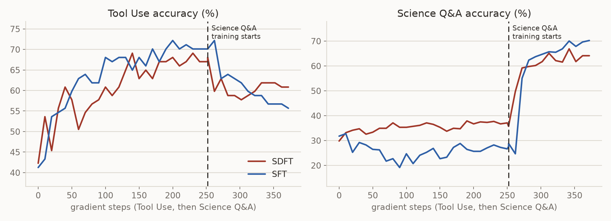

SDFT: learn from demonstrations without forgetting
==================================================

Self-Distillation Fine-Tuning (`arXiv:2601.19897
<https://arxiv.org/abs/2601.19897>`__) learns from demonstrations on policy.
The model that reads a demonstration in its prompt is the teacher. The same
model without the demonstration is the student. The student samples the
response and the loss pulls its next-token distributions toward the
teacher's. The paper reports higher new-task accuracy and less forgetting
than supervised fine-tuning on the same demonstrations.

+-------------+------------------------------------------------------------+
| Evolves     | model weights                                              |
+-------------+------------------------------------------------------------+
| Signal      | one report with the demonstration as ``teacher_context``   |
|             | per rollout                                                |
+-------------+------------------------------------------------------------+
| Loss family | ``sdft``                                                   |
+-------------+------------------------------------------------------------+
| Package     | ``recipes/sdft/``                                          |
+-------------+------------------------------------------------------------+
| Pipeline    | reported feedback, singleton                               |
+-------------+------------------------------------------------------------+
| Needs       | GPUs and the Slime training backend                        |
+-------------+------------------------------------------------------------+
| Example     | `SDFT on a skill stream                                    |
|             | <../../../recipes/sdft/examples/skill_stream/README.md>`__ |
+-------------+------------------------------------------------------------+

How it works
------------

The harness sends a request through Reef. It gets a demonstration of the
response from somewhere else, such as a reference solution or a stronger
model. It reports the demonstration against the request's receipt. With a
``job_samples`` and a batch size of 1, each report is one training step.

.. container:: flow

   Rollout
       the student answers a request

   Demonstration
       a reference response for the same request

   Report
       the demonstration as ``teacher_context`` against the rollout's receipt

   **Step**
       distil the demonstration-conditioned teacher on the student's own tokens

   Version
       publish the updated weights to the engine

   :Loop: the next request is served by the updated weights

SDFT has two pipeline stages
(`Training pipeline <../../developer-guide/write-a-recipe.rst>`__).
``SDFTSamples`` makes one sample from each report. The shared
``DistillJobData`` stage puts ``job_samples`` samples into one job's data, in
arrival order.

- **Teacher request.** ``SDFTSamples`` adds the demonstration block to the
  request's final user message, or as a new user message when the request
  ends in a tool result. ``context_template`` sets the block's text; its
  default is the reference implementation's wording. For another layout,
  subclass ``SDFTSamples``, override ``teacher_request``, and name the
  subclass in ``pipeline.record2sample.module``.
- **Rendering.** The training component renders the student's call and the
  teacher's request with the model's chat template. The teacher sequence is
  the teacher's request followed by the student's response tokens. The
  component leaves out a sample whose teacher sequence is longer than
  ``max_teacher_tokens`` and counts it in the job metric
  ``unrenderable_samples``.
- **Teacher weights.** The teacher is the model itself
  (``--sdft-teacher self``). It starts as a copy of the initial weights and,
  by default, moves 1% toward the policy after every step
  (``--sdft-teacher-update-rate``). In the skill stream example, a teacher
  that followed the policy drifted with it and training collapsed, so the
  example freezes the teacher with a rate of 0.
- **Loss.** The ``sdft`` loss family builds on the Slime backend's
  distillation base (`Loss families <../../developer-guide/loss-families.rst>`__)
  and runs as a ``custom_loss``. Before each step, one forward pass over
  every teacher sequence gives the teacher's next-token distribution at each
  response position. The loss is the per-token divergence from the student's
  distribution over the full vocabulary, forward KL by default. Each sample
  contributes the mean over its trained response tokens, weighted by the
  truncated importance-sampling ratio between the policy and the old-policy
  log-probs. The actor computes those with the weights of the job's start.
  The stage is on-policy, so the ratio is exact.

The report contract
-------------------

A report references one inference record and carries the demonstration as
``metadata.teacher_context``. A ``score`` is optional metadata and the
recipe never trains on it.

.. code:: json

   {
     "references": ["<receipt of the student's request>"],
     "metadata": {"teacher_context": "<the demonstration>"}
   }

Configuration
-------------

The deployment's top-level ``pipeline`` section configures the stages. Each
stage reads only its own ``config``.

.. code:: yaml

   recipe:
     implementation: recipes.sdft.recipe:SDFTRecipe
   pipeline:
     record2sample:
       config:
         max_teacher_tokens: 8192
     sample2job:
       config:
         job_samples: ${training.config.global_batch_size}
   training:
     config:
       global_batch_size: 32

.. container:: config

   ``pipeline.record2sample.config.max_teacher_tokens`` : 0
       the training component leaves out a sample with a longer teacher sequence and counts it in ``unrenderable_samples``. 0 disables the check. Set it to the trainer's window.

   ``pipeline.record2sample.config.context_template`` : the reference's block
       the text added to the final user message. ``{context}`` marks where the demonstration goes.

   ``pipeline.sample2job.config.job_samples`` : required
       rollouts in one job. Set it to ``training.config.global_batch_size`` so that one job is one optimizer step.

   ``training.config.global_batch_size``
       rollouts in one optimizer step. Reef passes it to Slime as ``--global-batch-size``. Each sample is its own data-parallel unit.

``SDFTSamples`` also takes the sample assembly's keys
(``accept_multi_turn_policy_samples``, ``realign_threshold`` and
``scaffold_tolerance``). Reef checks each stage's config when it loads the
recipe. A bad ``context_template`` or an unknown key fails the deployment. A
stage key under ``recipe.config`` also fails it, and the error names the
key's place in ``pipeline``.

Slime takes ``--loss-type custom_loss`` and
``--disable-compute-advantages-and-returns``, and refuses
``--use-rollout-logprobs``. Set ``--apply-chat-template-kwargs`` to the
serving engine's chat template arguments (`Chat template arguments
<../../reference/configuration-inference.rst#chat-template-arguments>`__). The family
adds its own flags:

.. container:: config

   ``--sdft-teacher`` : self
       who scores the samples. ``self`` is the model itself reading the demonstration. ``separate`` is another checkpoint of the same architecture set by ``--sdft-teacher-checkpoint``.

   ``--sdft-divergence`` : forward
       ``forward`` is KL(teacher \|\| student). ``reverse`` is KL(student \|\| teacher). ``jsd`` is the generalized Jensen-Shannon divergence and ``--sdft-jsd-beta`` sets the teacher's mixture weight with a default of 0.5.

   ``--sdft-top-k`` : 0
       keep the teacher's top-K log-probs and its log-prob at the sampled token. 0 keeps the whole distribution.

   ``--sdft-teacher-update-rate`` : 0.01
       fraction of the current policy mixed into the teacher's weights after every step. 1 makes the current policy the teacher and 0 freezes the initial weights.

   ``--sdft-importance-sampling-cap`` : 2.0
       cap of the truncated importance-sampling weight. 0 disables the correction.

   ``--sdft-skip-response-tokens`` : 0
       response tokens at the start of every sample left out of the loss. The paper's runs used 3.

The default full-vocabulary forward KL does not support `score centering
<../../developer-guide/loss-families.rst#score-centering>`__; only the
sampled reverse-KL mode does.

The teacher pass keeps one float16 block per sample on the host between the
pass and the step, with one row per response token and one column per
vocabulary entry on the rank. That is about 2 GB for a 16k-token response of
a 248k-vocabulary model at tensor parallel 4. Size ``max_teacher_tokens``
accordingly for long contexts. A moving teacher also keeps one more copy of
the actor's weights on the host per rank.

Run the example
---------------

The `example <../../../recipes/sdft/examples/skill_stream>`__ trains one
model on Tool Use and then on Science Q&A on an eight-GPU stack: four GPUs
for the actor and four for the serving engines. A judge scores
both skills every ten steps during both stages. The example's README
describes the protocol and the settings.

.. code:: bash

   cd recipes/sdft/examples/skill_stream
   hf download Qwen/Qwen2.5-7B-Instruct --local-dir ~/models/Qwen2.5-7B-Instruct
   ./run.sh

Results
-------

The figure shows one run of SDFT and one run of an SFT control on
Qwen2.5-7B-Instruct.

Tool Use training comes first and both methods learn it to about the same
level. SFT pushes Science Q&A below the base model and SDFT does not.

Science Q&A training comes second and both methods learn the new skill. SDFT
forgets only a little Tool Use and SFT forgets much more.

Related guides
--------------

- `Inference and feedback quickstart <../../getting-started/quickstart.rst>`__:
  learn the request, receipt, and report workflow.
- `Train model weights from agent feedback <../evolve-your-model.rst>`__:
  set up the GPU stack and inspect published updates.
- `Loss families <../../developer-guide/loss-families.rst>`__: how a family
  such as ``sdft`` plugs into the Slime backend, and the distillation base
  it is built on.
