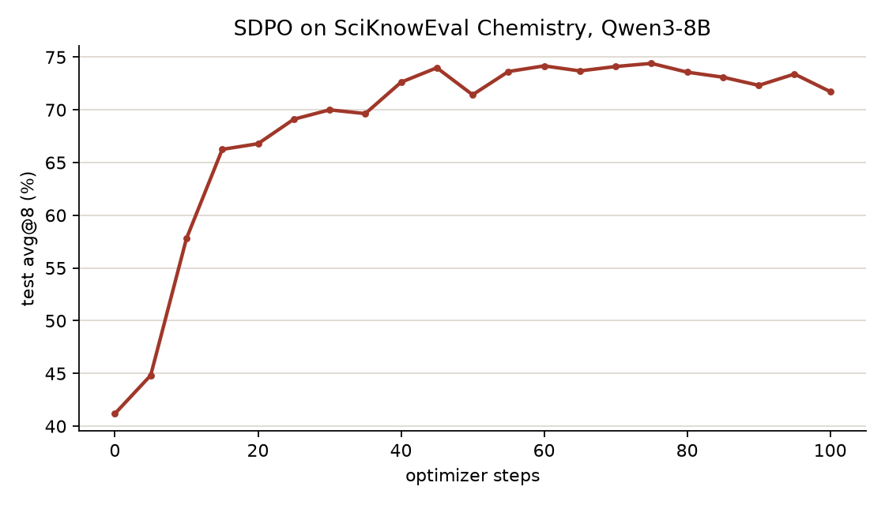

SDPO: learn from your own correct attempts
==========================================

Self-Distillation Policy Optimization (`arXiv:2601.20802
<https://arxiv.org/abs/2601.20802>`__) samples a question several times and
turns the attempts that succeed into teachers for the others. The teacher is
the model itself reading the question with a correct attempt appended. The
student reads the question alone. The loss pulls the student's next-token
distributions toward the teacher's on the student's own attempt. The paper
reports that SDPO reaches GRPO's accuracy with fewer samples.

+-------------+------------------------------------------------------------+
| Evolves     | model weights                                              |
+-------------+------------------------------------------------------------+
| Signal      | one report per attempt with its score and its place in the |
|             | sampling grid                                              |
+-------------+------------------------------------------------------------+
| Loss family | ``sdpo``                                                   |
+-------------+------------------------------------------------------------+
| Package     | ``recipes/sdpo/``                                          |
+-------------+------------------------------------------------------------+
| Pipeline    | reported feedback, one batch per sampling grid             |
+-------------+------------------------------------------------------------+
| Needs       | GPUs, and a backend that captures tokens and log-probs     |
+-------------+------------------------------------------------------------+
| Example     | `SDPO on SciKnowEval Chemistry                             |
|             | <../../../recipes/sdpo/examples/sciknoweval/README.md>`__  |
+-------------+------------------------------------------------------------+

What it does
------------

The harness samples each question several times through Reef and scores
every attempt. It reports each attempt with its score and its place in the
grid. The recipe waits for the whole grid and trains on it in one step.

.. flow::
   :loop: the next grid is sampled from the updated weights

   Rollout :: several attempts at each question
   Report :: each attempt's score and grid position against its receipt
   Step* :: distil the teacher that read a correct sibling onto each attempt
   Version :: publish the updated weights to the engine

How Reef implements it
----------------------

SDPO has three pipeline stages
(`Training pipeline <../../developer-guide/processors.rst>`__).
``SDPORecord2Record`` groups the reports of one grid. ``SDPOTasks`` turns
each rollout's report into a task. ``SDPOBatches`` batches one complete grid.

The teacher's request is the question with the first correct attempt by
another rollout appended, in the reference implementation's words. An attempt whose question no other rollout got right keeps the plain
request and a sample weight of 0. It stays in the step's mean and has no
target. A grid whose attempts came from different policy versions is dropped
and listed in the pipeline's status. A teacher sequence over
``max_teacher_tokens`` fails the step.

The ``sdpo`` loss family is a thin family on the Slime backend's
distillation base (`Loss families <../../developer-guide/loss-families.rst>`__)
and its defaults are the reference's. The teacher is a copy of the weights
that moves 5% toward the policy after every step. The loss is the
Jensen-Shannon divergence over the student's top 100 tokens plus one bucket
for the rest of the vocabulary. The student picks those tokens in one forward
before the step, so the trainer needs zero dropout. Each token's loss is
weighted by the capped ratio between the policy and the rollout engine's
log-probs.

The report contract
-------------------

A report references one attempt and carries its score and its place in the
grid. ``teacher_context`` is optional feedback for the teacher and the
example leaves it empty.

.. code:: json

   {
     "references": ["<receipt of the attempt>"],
     "score": 1.0,
     "metadata": {"step": 3, "group": 12, "rollout": 5, "teacher_context": ""}
   }

Configuration
-------------

The deployment's top-level ``pipeline`` section configures the three stages.
Each stage reads only its own ``config``. A later stage reads the values it
needs from an earlier stage:

- ``record2record`` (``SDPORecord2Record``) sets the grid. ``SDPOTasks``
  reads the grid from it.
- ``record2task`` (``SDPOTasks``) sets the teacher's tokenizer and windows.
  ``SDPOBatches`` reads them from it.
- ``task2batch`` (``SDPOBatches``) sets what the teacher reads.

.. code:: yaml

   recipe:
     implementation: recipes.sdpo.recipe:SDPORecipe
     config:
       max-staleness: 0
   pipeline:
     record2record:
       config:
         groups_per_step: 32
         rollouts_per_group: 8
     record2task:
       config:
         tokenizer_path: /models/Qwen3-8B
         max_teacher_tokens: 18944
     task2batch:
       config:
         include_environment_feedback: false

Reef checks each stage's config when it loads the recipe. A stage key under
``recipe.config`` fails the deployment, and the error names the key's place
in ``pipeline``.

.. config::

   pipeline.record2record.config.groups_per_step | 32 | questions in a grid.
   pipeline.record2record.config.rollouts_per_group | 8 | attempts at each question. At least 2.
   pipeline.record2task.config.tokenizer_path | required | the served model's tokenizer directory. It renders the teacher prompt with the engine's chat template.
   pipeline.record2task.config.max_teacher_prompt_tokens | 10240 | the rendered teacher prompt is cut to this many tokens.
   pipeline.record2task.config.max_teacher_tokens | 18432 | a longer teacher sequence fails the step. Set it to the trainer's window. Must be at least ``max_teacher_prompt_tokens``.
   pipeline.record2task.config.enable_thinking | false | the chat template's thinking switch, set as the engine sampled.
   pipeline.task2batch.config.success_reward_threshold | 0.5 | an attempt at or above this score is correct.
   pipeline.task2batch.config.allow_own_success_as_demonstration | false | let a correct attempt read its own response.
   pipeline.task2batch.config.remove_thinking_from_demonstration | true | strip ``<think>`` blocks from the demonstration.
   pipeline.task2batch.config.include_environment_feedback | false | add the report's ``teacher_context`` to the teacher's prompt.
   pipeline.task2batch.config.environment_feedback_only_without_solution | true | use the feedback only when no correct sibling exists.
   recipe.config.max-staleness | 0 | accepted lag between the producing and serving version.

``SDPOTasks`` also takes the sample assembly's keys
(``accept_multi_turn_policy_samples``, ``realign_threshold`` and
``scaffold_tolerance``). One batch is always one grid, so ``SDPOBatches``
takes no ``batch_size``.

The Slime driver takes ``--loss-type custom_loss`` and
``--use-rollout-logprobs`` and ``--disable-compute-advantages-and-returns``.
The family adds its own flags:

.. config::

   --sdpo-teacher | self | ``self`` is the model itself. ``separate`` is another checkpoint set by ``--sdpo-teacher-checkpoint``.
   --sdpo-divergence | jsd | ``forward``, ``reverse`` or ``jsd``. ``--sdpo-jsd-beta`` is the teacher's weight in the mixture and defaults to 0.5.
   --sdpo-top-k | 100 | tokens per position the divergence is computed on. 0 keeps the whole distribution.
   --sdpo-top-k-source | student | who picks the tokens, ``student`` or ``teacher``.
   --sdpo-top-k-distribution | tail | ``tail`` keeps the rest of the vocabulary as one bucket. ``renormalized`` conditions on the picked tokens.
   --sdpo-teacher-update-rate | 0.05 | fraction of the policy mixed into the teacher after every step. 0 freezes the initial weights.
   --sdpo-importance-sampling-level | token | ``token`` weights each token by its own ratio. ``sequence`` averages the ratio over the response.
   --sdpo-importance-sampling-cap | 2.0 | cap of the importance weight. 0 disables the correction.
   --sdpo-skip-response-tokens | 0 | response tokens at the start of every attempt left out of the loss.

The sampled reverse-KL mode also accepts score centering for training/inference
mismatch. See `Score centering <../../developer-guide/loss-families.rst#score-centering>`__
for the required loss options and sampler top-K capture. The default JSD
over top-K plus a tail bucket does not support it.

Run the example
---------------

The `example <../../../recipes/sdpo/examples/sciknoweval>`__ trains Qwen3-8B
on the Chemistry split of SciKnowEval on four GPUs. Each step samples 32
questions eight times and the test split is scored every five steps. The
example's README describes the protocol.

.. code:: bash

   cd recipes/sdpo/examples/sciknoweval
   hf download Qwen/Qwen3-8B --local-dir ~/models/Qwen3-8B
   ./run.sh

Results
-------

One run of 100 steps. Test accuracy goes from 41.2% to 74.4% at step 75 and
ends at 71.7%. The rollouts stay diverse and a question seen a second time is
answered no better than the rest of the grid.

Related guides
--------------

- `Inference and feedback quickstart <../../getting-started/quickstart.rst>`__:
  learn the request, receipt, and report workflow.
- `Train model weights from agent feedback <../evolve-your-model.rst>`__:
  set up the GPU stack and inspect published updates.
- `Loss families <../../developer-guide/loss-families.rst>`__: how a family
  such as ``sdpo`` plugs into the Slime backend, and the distillation base
  it is built on.
