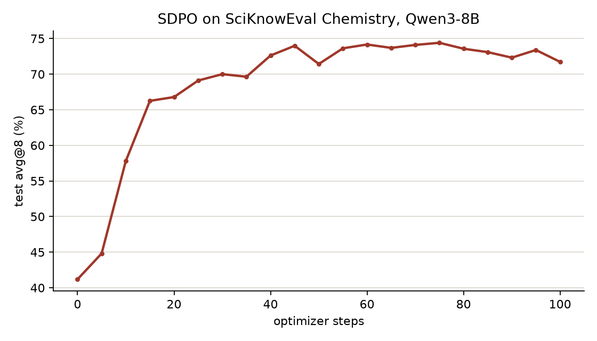

SDPO: learn from your own correct attempts
==========================================

Use Self-Distillation Policy Optimization
(`SDPO <https://arxiv.org/abs/2601.20802>`__) when a task has a score for each
attempt. Successful sibling attempts become demonstrations for the others.
The student trains on its own response tokens. Reef requires Slime and GPUs.

Run the example
---------------

The `SciKnowEval example
<../../../recipes/sdpo/examples/sciknoweval/README.md>`__ trains Qwen3-8B
on Chemistry. Use the Slime training environment with eight GPUs:
four for training and four for serving.

.. code:: bash

   cd recipes/sdpo/examples/sciknoweval
   hf download Qwen/Qwen3-8B --local-dir ~/models/Qwen3-8B
   ./run.sh

Each step samples 32 questions eight times. The example evaluates the test
split every five steps; its README records the protocol.

How it works
------------

1. Sample several attempts for each question through Reef.
2. Report every attempt's score and position in the sampling grid.
3. Wait for the complete grid, then train and publish the updated weights.
4. Sample the next grid from the new artifact.

Each attempt uses the first correct sibling as its demonstration by default.
Without a correct sibling, it keeps the plain request and has weight 0.
It remains in the step's mean but supplies no target.
Reef drops grids that mix policy versions. Responses from an artifact that
no longer serves do not train.

The default loss is Jensen-Shannon divergence over the student's top 100
tokens, plus a bucket for the remaining vocabulary. The teacher moves 5%
toward the policy after each step. Use zero dropout for the student-selected
token representation.

Reef cuts the teacher prompt to ``max_teacher_prompt_tokens`` before adding
the student's response. Samples above ``max_teacher_tokens`` do not train;
``unrenderable_samples`` counts the exclusions.

The report contract
-------------------

A report references one attempt and carries its score and its place in the
grid. ``teacher_context`` is optional feedback for the teacher and the
example leaves it empty.

.. code:: json

   {
     "references": ["<receipt of the attempt>"],
     "score": 1.0,
     "metadata": {"step": 3, "group": 12, "rollout": 5, "teacher_context": ""}
   }

Configuration
-------------

Set the grid and teacher limits under ``record2sample``. Set demonstration
selection and job size under ``sample2job``:

.. code:: yaml

   recipe:
     implementation: recipes.sdpo.recipe:SDPORecipe
   pipeline:
     record2sample:
       config:
         groups_per_step: 32
         rollouts_per_group: 8
         max_teacher_tokens: 18944
     sample2job:
       config:
         job_samples: ${training.config.global_batch_size}
         include_environment_feedback: false
   training:
     config:
       global_batch_size: 256           # groups_per_step x rollouts_per_group
     options:
       apply-chat-template-kwargs: '{"enable_thinking": false}'   # as the engine samples

.. container:: config

   ``pipeline.record2sample.config.groups_per_step`` : 32
       questions in a grid.

   ``pipeline.record2sample.config.rollouts_per_group`` : 8
       attempts at each question. At least 2.

   ``pipeline.record2sample.config.max_teacher_prompt_tokens`` : 10240
       the rendered teacher prompt is cut to this many tokens.

   ``pipeline.record2sample.config.max_teacher_tokens`` : 18432
       Maximum teacher sequence length. Must be at least
       ``max_teacher_prompt_tokens`` and fit the trainer's context window.

   ``training.options.apply-chat-template-kwargs`` : none
       JSON chat template arguments. Match serving, including thinking mode.

   ``pipeline.sample2job.config.job_samples`` : required
       Minimum samples per job. Set it to the complete grid size.

   ``pipeline.sample2job.config.success_reward_threshold`` : 0.5
       an attempt at or above this score is correct.

   ``pipeline.sample2job.config.allow_own_success_as_demonstration`` : false
       let a correct attempt read its own response.

   ``pipeline.sample2job.config.remove_thinking_from_demonstration`` : true
       strip ``<think>`` blocks from the demonstration.

   ``pipeline.sample2job.config.include_environment_feedback`` : false
       add the report's ``teacher_context`` to the teacher's prompt.

   ``pipeline.sample2job.config.environment_feedback_only_without_solution`` : true
       use the feedback only when no correct sibling exists.

The record stage also accepts ``accept_multi_turn_policy_samples``,
``realign_threshold``, and ``scaffold_tolerance``. Put stage settings under
``pipeline``; placing them in ``recipe.config`` stops startup.

One job contains one grid. Set ``job_samples`` and Slime's
``--global-batch-size`` to ``groups_per_step x rollouts_per_group`` for one
update per grid. A larger ``job_samples`` fails pipeline construction.
Keep ``buffer_size`` at its default, ``job_samples``; a larger value can
combine two grids and fail job preparation.

Slime takes ``--loss-type custom_loss`` and
``--disable-compute-advantages-and-returns``, and refuses
``--use-rollout-logprobs``. The family adds its own flags:

.. container:: config

   ``--sdpo-teacher`` : self
       ``self`` is the model itself. ``separate`` is another checkpoint set by ``--sdpo-teacher-checkpoint``.

   ``--sdpo-divergence`` : jsd
       ``forward``, ``reverse``, or ``jsd``. ``--sdpo-jsd-beta`` sets the
       teacher's mixture weight; default 0.5.

   ``--sdpo-top-k`` : 100
       tokens per position the divergence is computed on. 0 keeps the whole distribution.

   ``--sdpo-top-k-source`` : student
       who picks the tokens, ``student`` or ``teacher``.

   ``--sdpo-top-k-distribution`` : tail
       ``tail`` keeps the rest of the vocabulary as one bucket. ``renormalized`` conditions on the picked tokens.

   ``--sdpo-teacher-update-rate`` : 0.05
       Fraction of policy weights mixed into the teacher after each step.
       0 freezes the initial weights.

   ``--sdpo-importance-sampling-level`` : token
       ``token`` weights each token by its own ratio. ``sequence`` averages the ratio over the response.

   ``--sdpo-importance-sampling-cap`` : 2.0
       cap of the importance weight. 0 disables the correction.

   ``--sdpo-skip-response-tokens`` : 0
       response tokens at the start of every attempt left out of the loss.

The default JSD over top-K plus a tail bucket does not support `score
centering <../../developer-guide/loss-families.rst#score-centering>`__; only
the sampled reverse-KL mode does.

Results
-------

In one 100-step run, test avg@8 rose from 41.2% to 74.4% at step 75,
then ended at 71.7%. This is mean accuracy across eight attempts, not pass@8.
The run does not estimate variance across seeds.

Related guides
--------------

- `Inference and feedback quickstart <../../getting-started/quickstart.rst>`__:
  learn the request, receipt, and report workflow.
- `Train model weights from agent feedback <../evolve-your-model.rst>`__:
  set up the GPU stack and inspect published updates.
- `Loss families <../../developer-guide/loss-families.rst>`__: how a family
  such as ``sdpo`` plugs into the Slime backend, and the distillation base
  it is built on.
