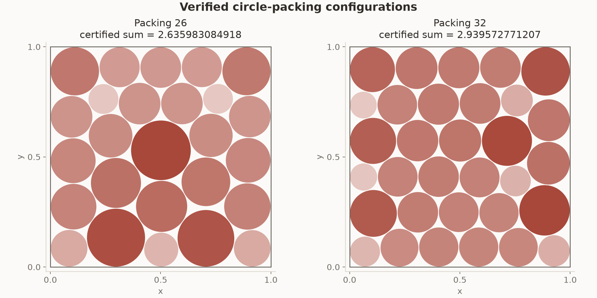

TTT-Discover: train a model at test time
========================================

TTT-Discover (`arXiv:2601.16175 <https://arxiv.org/abs/2601.16175>`__) specializes
a model to one problem while it searches for the highest-scoring solution. The
harness selects candidate programs, asks the model to improve them, evaluates
the generated programs, and adds valid candidates to a PUCT archive. Reef trains
the scenario's LoRA adapter after it receives one complete rollout grid. The next
search step uses the updated adapter.

+-------------+------------------------------------------------------------+
| Evolves     | model weights                                              |
+-------------+------------------------------------------------------------+
| Signal      | a finite ``score`` per rollout, addressed into a step grid |
+-------------+------------------------------------------------------------+
| Loss family | ``tttd``                                                   |
+-------------+------------------------------------------------------------+
| Package     | ``recipes/tttd/``                                          |
+-------------+------------------------------------------------------------+
| Pipeline    | reported feedback, grouped                                 |
+-------------+------------------------------------------------------------+
| Needs       | GPUs, and a harness that already runs a search loop        |
+-------------+------------------------------------------------------------+
| Example     | ``recipes/tttd/examples/tttd/``                            |
+-------------+------------------------------------------------------------+

How one step runs
-----------------

Run one scenario per problem.

.. container:: flow

   Select parents
       PUCT chooses one parent for each group

   Generate rollouts
       each group samples sibling programs

   Evaluate and report
       the task judge returns one score per rollout

   Complete the grid
       Reef waits for every configured coordinate

   Train the adapter
       Slime and Megatron perform one optimizer step

   Publish weights
       SGLang loads the scenario's new LoRA revision

   Commit search state
       the controller records the matching PUCT archive

   :Loop: use the committed adapter for the next search step

- **Search.** The harness chooses ``groups_per_step`` parents and samples
  ``rollouts_per_group`` programs from each. A prompt contains the task
  instruction. When the parent has a valid program, the prompt also contains
  that program, its reward, and the end of its recorded output.
- **Inference.** Every model request passes through Reef's OpenAI-compatible
  chat endpoint. Reef answers with the scenario's current adapter and records
  the exchange with the artifact that answered.
- **Report.** The task judge executes each program and computes its reward.
  The harness reports the reward against the inference receipt, with the
  rollout's grid coordinate (`The report contract`_).
- **Grid.** The record-to-sample stage, ``TTTDSamples``, waits for every
  coordinate of the step. It discards a grid whose rollouts came from more
  than one artifact. ``TTTDJobData`` then removes each group whose siblings
  all have the same reward. If every group is constant, it keeps one group,
  and the step has zero gradient.
- **Training.** Slime computes adaptive-beta entropic leave-one-out advantages
  within each group. The loss has no PPO clipping and adds a centered token
  KL against the frozen base model. The training component renders each
  rollout with the model's chat template and computes the old-policy log
  probabilities with the weights of the step's start. The stage is on-policy,
  so these weights sampled the grid. Slime refuses ``--use-rollout-logprobs``.
- **Commit.** The controller writes the updated archive to
  ``tttd-search-state.json`` with phase ``pending``. It waits until Reef's
  commit number advances and the served artifact (``served_artifact_id``)
  changes. It then records phase ``committed`` and starts the next step.

The archive retains the best candidate found so far. The mean rollout reward
describes the programs sampled for one step, so it can decrease while the best
archived solution does not change.

The report contract
-------------------

Every rollout reports a finite ``score`` against the receipt of its inference
request. The report's ``metadata`` identifies one coordinate in the step grid.
Reef validates these fields when it receives the report.

+------------------------+----------+--------------------------------------------+
| ``metadata`` field     | Required | Rule                                       |
+========================+==========+============================================+
| ``algorithm``          | no       | ``tttd`` or ``ttt-discover``; defaults to  |
|                        |          | ``tttd``                                   |
+------------------------+----------+--------------------------------------------+
| ``step``               | yes      | ``>= 0``                                   |
+------------------------+----------+--------------------------------------------+
| ``group``              | yes      | ``0 <= group < groups_per_step``           |
+------------------------+----------+--------------------------------------------+
| ``rollout``            | yes      | ``0 <= rollout < rollouts_per_group``      |
+------------------------+----------+--------------------------------------------+
| ``groups_per_step``    | yes      | ``>= 1``; must match the served grid       |
+------------------------+----------+--------------------------------------------+
| ``rollouts_per_group`` | yes      | ``>= 2``; must match the served grid       |
+------------------------+----------+--------------------------------------------+
| ``comparison_set``     | no       | must equal                                 |
|                        |          | ``tttd-step-<step>-group-<group>``;        |
|                        |          | derived when omitted                       |
+------------------------+----------+--------------------------------------------+

.. code:: python

   client.report(scenario, {
       "score": reward,
       "metadata": {
           "step": step,
           "group": group,
           "rollout": rollout,
           "groups_per_step": groups_per_step,
           "rollouts_per_group": rollouts_per_group,
       },
   }, references=[receipt])

The `cookbook harness <../../../recipes/tttd/examples/tttd/README.md>`__ keeps
the PUCT search separate from its Reef adapter. The search code imports no
Reef client and builds no report payloads.

Configuration
-------------

The recipe has two pipeline stages, ``TTTDSamples`` and ``TTTDJobData``. The
deployment's ``pipeline`` section configures them. Write the step grid once, in
the record-to-sample stage. ``TTTDJobData`` reads the grid from ``TTTDSamples``.

.. code:: yaml

   recipe:
     implementation: recipes.tttd.recipe:TTTDRecipe
   pipeline:
     record2sample:
       config:
         groups_per_step: 8
         rollouts_per_group: 64
     sample2job:
       config:
         job_samples: 512       # the grid: groups_per_step x rollouts_per_group

.. container:: config

   ``pipeline.record2sample.config.groups_per_step`` : 8
       comparison groups in one step; at least one.

   ``pipeline.record2sample.config.rollouts_per_group`` : 64
       siblings per group; at least two, since a group of one has no relative reward.

   ``pipeline.record2sample.config.accept_multi_turn_policy_samples`` : false
       train a report's trajectory of several model calls as one multi-turn sample; otherwise the report trains only the trajectory's last call.

   ``pipeline.sample2job.config.job_samples`` : required
       the fewest samples of one job; at most the grid's rollouts. Set it to the grid.

One job's data is always one complete grid. To train one optimizer step per
grid, set ``job_samples`` and the backend's batch size, such as Slime's
``--global-batch-size``, to ``groups_per_step x rollouts_per_group``.

- With a ``job_samples`` larger than the grid, the scenario's pipeline fails
  to build.
- Leave ``pipeline.sample2job.config.buffer_size`` at its default,
  ``job_samples``. A larger value can put two grids in one job's data, and
  ``TTTDJobData`` then raises an error.
- Reef refuses ``groups_per_step`` or ``rollouts_per_group`` under
  ``recipe.config`` and names the key's place in ``pipeline``.

Run the example
---------------

The example runs the Erdős minimum-overlap problem and the circle-packing
problems for 26 and 32 circles with Qwen3-8B. It starts Ray, Slime, Megatron,
SGLang, Reef, reef-eval, and the selected Harbor task on one machine. It
requires Linux, four NVIDIA GPUs, Docker, and the Reef training dependencies
described in `Installation <../../getting-started/installation.rst>`__. Run the
following commands from the repository root:

.. code:: bash

   git submodule update --init third_party/reef-client
   python -m pip install -e ./third_party/reef-client
   python -m pip install -e .
   cd recipes/tttd/examples/tttd
   ./run.sh

``run.sh`` downloads ``Qwen/Qwen3-8B`` into ``work/model`` on its first run,
starts the stack, and runs one rollout of ``harbor/erdos_min_overlap`` on the
paper grid: eight groups of 64 rollouts, one optimizer step, thinking enabled.
Two GPUs train the actor and two serve the policy.

Reef writes its service log to ``work/erdos_min_overlap/reef.log``. The status
endpoint reports the commit number (``commit_number``) and the served artifact
(``served_artifact_id``):

.. code:: bash

   curl -s \
     -H "Authorization: Bearer reef-local" \
     http://127.0.0.1:8900/reef/status

The controller returns an error when the rollout count, commit number, served
artifact, or stored search identity does not match the current run. A successful
exit confirms that Reef committed the requested number of training steps.

Choose a problem
~~~~~~~~~~~~~~~~

``TTTD_TASK`` is the only user-facing environment variable. It selects one of
the three Harbor tasks; Erdős is the default.

+-----------------------+-----------------------+---------------------------------------+-----------------+
| Value                 | Generated entry point | Reward                                | Program timeout |
+=======================+=======================+=======================================+=================+
| ``erdos_min_overlap`` | ``run()``             | Reciprocal of the verified C5 bound   | 1,100 seconds   |
+-----------------------+-----------------------+---------------------------------------+-----------------+
| ``circle_packing_26`` | ``run_packing()``     | Verified sum of 26 circle radii       | 530 seconds     |
+-----------------------+-----------------------+---------------------------------------+-----------------+
| ``circle_packing_32`` | ``run_packing()``     | Verified sum of 32 circle radii       | 530 seconds     |
+-----------------------+-----------------------+---------------------------------------+-----------------+

.. code:: bash

   TTTD_TASK=circle_packing_26 ./run.sh

Each task has its own scenario and its own state directory, ``work/<task>/``.
The judges run each submitted program in a subprocess and recompute the
returned quantity. They do not use a value that the program reports.

Change the search budget
~~~~~~~~~~~~~~~~~~~~~~~~

``serve.yaml`` holds the grid and the training settings, and the harness reads
the same file. Slime's ``global-batch-size`` and ``job_samples`` in that file
must equal ``groups_per_step x rollouts_per_group``.

.. list-table::
   :header-rows: 1

   * - Setting
     - Default
     - Meaning
   * - ``pipeline.record2sample.config.groups_per_step``
     - 8
     - Parents selected for one step.
   * - ``pipeline.record2sample.config.rollouts_per_group``
     - 64
     - Sibling rollouts sampled from each parent.
   * - ``training.config.steps``
     - 1
     - Search and optimizer steps. Slime reads it as ``--num-rollout``.
   * - ``training.config.max_new_tokens``
     - 26000
     - Maximum completion length.
   * - ``training.config.enable_thinking``
     - true
     - Qwen3 chat-template thinking mode. The key is absent from the shipped
       ``serve.yaml``.
   * - ``training.config.num_gpus``
     - 2
     - The actor's GPUs. ``inference.num-gpus`` gives the two serving engines
       their own two GPUs.

``run.sh`` and the harness set the per-task limits:

.. list-table::
   :header-rows: 1

   * - Limit
     - Erdős
     - Circle packing
   * - ``TTTD_SEQ_LENGTH``, the training sequence length
     - 30000
     - 32768
   * - ``TTTD_MAX_TOKENS_PER_GPU``
     - 30000
     - 16384
   * - ``TTTD_LOG_PROBS_CHUNK_SIZE``
     - 1024
     - 512
   * - ``MAX_WORKERS`` in ``harness/harbor_agent.py``, the concurrent rollout
       and evaluator calls
     - 512
     - 256

Training starts only after all coordinates have arrived. Completion length and
evaluator concurrency determine GPU memory, host memory, and CPU use. Test the
intended grid for one step before you request a long run. A reduced smoke run
can use two groups of two rollouts, one step, and thinking disabled.

Results
-------

Each run used Qwen3-8B with thinking enabled on two NVIDIA B200 GPUs: eight
groups of 64 programs per step, then one rank-32 LoRA update with an Adam
learning rate of ``4e-5``. Each task has one trajectory, so these results do
not estimate variance across seeds.

.. list-table::
   :header-rows: 1

   * - Task
     - Steps
     - Certified result
     - TTT-Discover
     - Target
   * - Erdős minimum overlap (``C5`` upper bound, lower is better)
     - 25
     - ``0.38094``
     - ``0.38093``
     - ``0.38080``
   * - Packing 26 (sum of radii, higher is better)
     - 50
     - ``2.635983``
     - ``2.635983``
     - ``2.636``
   * - Packing 32 (sum of radii, higher is better)
     - 50
     - ``2.939573``
     - ``2.939572``
     - ``2.940``

The certified results come from the task judges and the best programs in the
search archives, not from the mean rollout reward. The `Erdős result details
<../../../recipes/tttd/examples/tttd/results/formal-8x64-v3-erdos/README.md>`__
and the `circle-packing overview
<../../../recipes/tttd/examples/tttd/results/formal-8x64-v3-packing/README.md>`__
hold the run configurations, numeric histories, saved programs, training
metrics, and W&B run IDs.

Enable W&B tracking
-------------------

The example disables W&B in ``serve.yaml``. Set ``observability.wandb.enabled``
to ``true`` before you start the stack, and give a project and an optional
entity. Export ``WANDB_API_KEY`` or log in through the cluster's credential
store; do not put the key in YAML, tags, run names, or Slime flags.
`Experiment tracking <../../reference/configuration.rst#experiment-tracking>`__
describes every key, run identity, and the metric names.

When ``TTTDJobData`` receives a complete grid, it records these metrics in the
``tttd`` namespace. They describe every evaluated rollout, before the
constant-reward groups are removed.

.. list-table:: TTT-Discover search metrics
   :header-rows: 1

   * - Metric
     - Meaning
   * - ``tttd/step``
     - Zero-based search step reported by the harness.
   * - ``tttd/reward_min``, ``tttd/reward_max``, ``tttd/reward_mean``
     - Minimum, maximum, and mean reward over the complete grid.
   * - ``tttd/reward_std``
     - Population standard deviation of rewards over the complete grid.
   * - ``tttd/reward_zero_fraction``
     - Fraction of grid rewards equal to zero. In the bundled tasks, zero is
       also the reward of an invalid solution.
   * - ``tttd/constant_groups``, ``tttd/constant_groups_removed``
     - Constant-reward groups, and the number removed before training.
   * - ``tttd/grid_groups``, ``tttd/grid_rollouts``
     - Size of the completed grid.
   * - ``tttd/training_groups``, ``tttd/training_rollouts``
     - Size of the job's data after constant-reward filtering.

The harness also writes ``archive_size`` and ``archive_best_reward`` in each
``tttd_step_committed`` log event. They show whether the archive still improves
after the mean grid reward stops improving.

Inspect checkpoints and resume state
------------------------------------

Each task stores its durable files under ``work/<task>/``:

.. code:: text

   work/<task>/
     reef.log
     tttd-search-state.json
     agent-record/
     artifacts.git/
     checkpoints/
     stack/
     wandb/

The search state holds a search identity: the scenario, model, recipe,
task-instruction hash, grid dimensions, completion length, sampling settings,
PUCT exploration constant, and invalid reward. A restart with a different
identity stops before it uses an incompatible archive. The controller also
refuses a state file of an older format.

On restart, the controller reads the phase of the last step:

- ``pending``: the step's children are evaluated, and the controller has not
  seen the commit. The controller waits for that commit.
- ``committed``: the state records the commit number and the served artifact
  ID. The served artifact can change without a step, for example when an
  operator activates another artifact. The controller accepts the artifact
  that serves after Reef restores the expected commit number, and records it.

The example saves a checkpoint after each step (``save-interval: "1"``) and
retains the latest checkpoint. Select the interval before the run. The
retention policy controls which completed checkpoints remain stored; it does
not change the interval. `State model <../../advanced_topics/state-model.rst>`__
describes commits and recovery.

Add another problem
-------------------

1. Create a sibling directory under ``recipes/tttd/examples/tttd/harbor/``
   with a ``task.toml``, an ``instruction.md``, a judge service, and a
   verifier that writes the final Harbor reward.
2. Add the task's name to the ``TASKS`` tuple in ``run.py`` and to the
   ``case`` statement in ``run.sh``, with its sequence and memory limits. The
   harness derives the scenario and the state directory from ``TTTD_TASK``.
3. Adjust ``MAX_WORKERS`` in ``harness/harbor_agent.py`` when the existing
   value does not apply.

The shared harness sends every extracted Python program to the selected judge.
The judge's ``grade(artifact)`` function must return a finite reward for a valid
program and the defined invalid reward for a failed program. Keep the program
contract in the instruction consistent with the judge, and start a new scenario
when that contract changes.

Add tests for the program contract, invalid outputs, reward calculation, and
task registration. ``tests/recipes/tttd/test_tttd_harness.py`` and
``tests/recipes/tttd/test_tttd_packing_tasks.py`` show how the shared harness
hands programs to a task-specific judge.

Related guides
--------------

- `Guidance-TTT <guidance-ttt.rst>`__: train a guidance model with a frozen
  executor on four discovery tasks.
- `Train model weights from agent feedback <../evolve-your-model.rst>`__:
  set up the GPU stack and inspect published updates.
- `HTTP API reference <../../reference/http-api.rst>`__: connect your agent
  and query feedback, scenarios, and artifacts.
