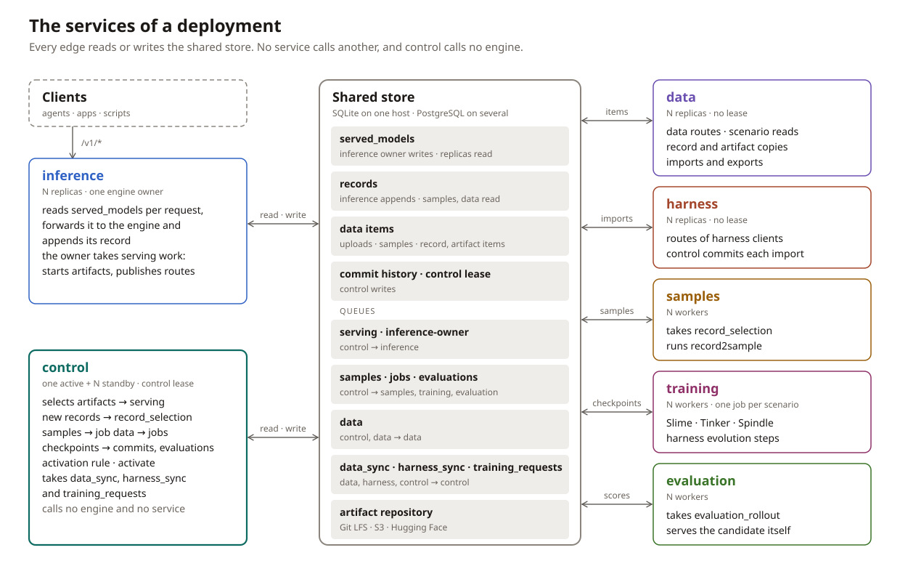

Run the services in separate processes
======================================

Run services separately to scale them independently or keep inference available
during control restarts. Start from a working single-process deployment.

The seven services coordinate through shared stores and work queues.
By default, ``reef serve`` runs them in one process.

Start the services
------------------

Use the same configuration for every service. Run each command in its own
process or supervisor:

.. code:: bash

   export REEF_TOKEN="$(openssl rand -hex 16)"
   reef serve -c deploy.yaml --service control --reef.port 8901
   reef serve -c deploy.yaml --service inference --reef.port 8902
   reef serve -c deploy.yaml --service samples --reef.port 8903
   reef serve -c deploy.yaml --service training --reef.port 8904
   reef serve -c deploy.yaml --service evaluation --reef.port 8905
   reef serve -c deploy.yaml --service data --reef.port 8906
   reef serve -c deploy.yaml --service harness --reef.port 8907

A ``--service`` process starts no other Reef service.
Start the external engines and training backends that the configuration requires.

Every process must reach the same stores:

- On one host, share SQLite files under ``storage.agent-record-dir``.
  On several hosts, use ``storage.record-backend: postgres``.
  Coordination uses schema ``<record schema>_coordination``.
- Share ``storage.data-store`` and the task and segment stores it uses.
  The data store follows the record backend by default; see
  `Data storage <storage.rst#choose-the-data-store>`__.
- Share ``storage.artifact-backend``. Training needs write access to save checkpoints.

Give each process separate ``storage.artifact-work-dir`` and
``storage.artifact-cache-dir`` paths. Shared working copies can corrupt concurrent fetches.

Send each request to its service
--------------------------------

.. list-table::
   :header-rows: 1
   :widths: 20 80

   * - Service
     - Routes
   * - ``inference``
     - ``/v1/chat/completions``, ``/v1/responses``, ``/v1/messages``, ``/v1/messages/count_tokens``, the evaluation routes, the routes of each served artifact, and ``GET /reef/scenarios/{scenario}/inference/status``.
   * - ``data``
     - The ``/reef/namespaces/{owner}/data...`` routes, artifact file reads and
       ``GET /reef/scenarios/{scenario}/jobs``. Only data serves these routes.
       Data and control both answer scenario reads: lists, settings, contracts,
       records, commits, artifacts, samples, tasks, evaluations and rollouts.
   * - ``harness``
     - ``GET /reef/harness``, ``GET /reef/harness/artifacts``, ``POST /reef/harness/import`` and ``GET /reef/harness/adapters``.
   * - ``control``
     - Other routes: scenario writes, next-job reads, training cancellation,
       ``/reef/status``, harness snapshot and request pages, and step records.
   * - ``samples``, ``training``, ``evaluation``
     - ``/healthz`` only. They take their work from queues.

Data and harness services need no control lease. You can run several replicas
of each behind one address. A one-process ``reef serve`` answers all routes.

Inference
---------

Poll ``GET /reef/scenarios/{scenario}/inference/status`` after changing served
artifacts. Inference requests return 503 during startup; unknown or nonserving
scenarios return 404. See `inference errors
<../reference/http-api-inference.rst#request>`__.

Control retries failed startup after 60 seconds, doubling the delay to at
most one hour. Resending ``served`` retries immediately and resets the delay.

One worker owns the runtime under a lease; replicas answer requests. On
takeover, it removes routes outside the new runtime before opening it. Local
addresses usually change, so requests return 503 until selections reload.
Remote routes survive only when the runtime confirms them. Native engines
restart and interrupt requests. Startup status is not a continuous health check.

Use the same Reef version throughout. Keep engine addresses private and
restart the inference component after resetting coordination storage.
A failed adapter load leaves the engine unavailable; fix the artifact or
restart the worker. A native control call that hangs requires operator recovery.
See `request pinning and control deadlines
<../developer-guide/serving-runtimes.rst#request-pinning>`__.

Training
--------

Install the selected backend's dependencies and credentials on the training
service: `Slime <evolve-your-model.rst>`__, `Tinker <tinker.rst>`__ or the
`harness binary and sandbox <evolve-your-harness.rst>`__.

Training reads starts and writes checkpoints through shared artifact storage.
Other services need no shared training directory. While training is unavailable,
new jobs wait for admission without consuming samples or appearing as running.
Tinker/Spindle imports return 503 after 60 seconds without a training-service response.

For harness recipes, keep ``evolution.state_dir`` on the training host.
It owns evolution runs and archives history after scenario deletion.

Harness clients
---------------

Point harness clients at the harness service. Set ``harness.inference_url``
to the address those clients can reach for model calls.

Control merges imported files. After 30 seconds without a response, import
returns 503 but stays queued. Resending the same files waits for that request.

Data
----

Data writes wait up to 30 seconds for control to sync the scenario.
``synced: false`` means the write remains pending synchronization, not lost.
The next control cycle or scenario load applies it.

Evaluation
----------

Evaluation requires inference. Candidates load without changing production
routes, and evaluation calls do not become training records.

Choose graceful shutdown with ``evaluation.on-stop`` and
``evaluation.finish-timeout-s``. Keep the timeout below the supervisor's kill
deadline. Graceful requeue consumes no attempt; a forced kill consumes one
and waits for lease expiry. See `evaluation settings
<../reference/configuration-settings.rst#evaluation>`__.

Control restarts
----------------

While control is down:

- Inference keeps serving loaded artifacts and recording requests.
  Control restarts do not reopen engines.
- Queued training jobs, sample requests and evaluation rollouts continue.
  Control must return before it can submit new work.
- Data accepts writes. Each write waits 30 seconds for control to sync it,
  then returns ``"synced": false``.

**Standby instances.** Run one active control instance and any number of
standby instances on the same store:

- The active instance holds the control lease and extends it.
- A standby waits for the lease. It loads no scenarios and answers no
  requests, including ``/healthz``. Use that probe to route traffic to the
  active instance.
- A normal stop releases the lease; a standby takes over within 10 seconds.
  After a crash, takeover waits for lease expiry (30 seconds).
- An instance that loses its lease stops its training work and exits.
  Its supervisor can restart it as a standby.

For a control upgrade, start the new instance as a standby. Then stop the old instance.
