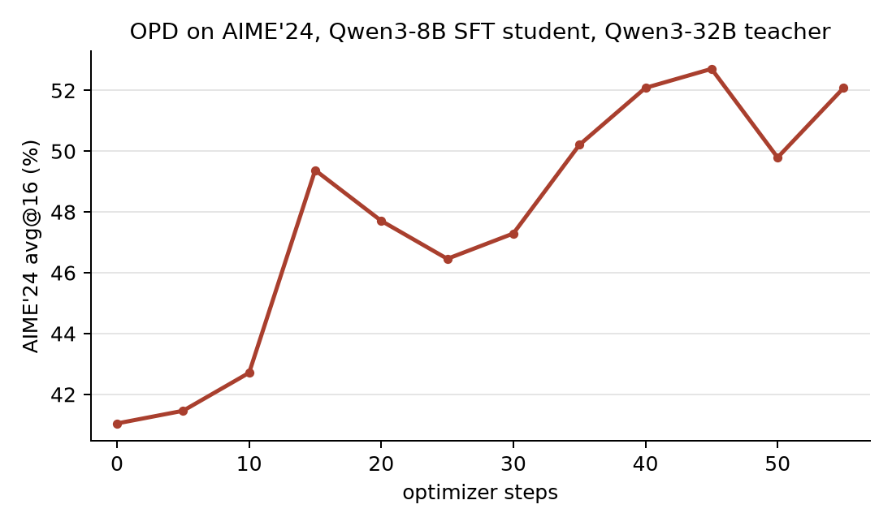

# OPD on mathematical reasoning

This example distils `Qwen/Qwen3-32B` into a Qwen3-8B-Base student that was
fine-tuned on OpenThoughts3 math with the `opd` recipe (`recipes/opd/`), and
evaluates on AIME'24. The teacher is four times the student's size and shares
only its tokenizer, so it runs on the recipe's teacher engine instead of inside
the actor. Each update samples 64 prompts four times through Reef, the teacher
scores every token the student generated, and one optimizer step moves the
student toward the teacher. Every five updates the served student is scored on
AIME'24 and that series is the learning curve.

The method follows the
[Thinking Machines write-up](https://thinkingmachines.ai/blog/on-policy-distillation/),
which used the same Qwen3-8B/Qwen3-32B pair after SFT on about 400k examples
and reported AIME'24 moving from about 60% to 70%. This example starts from a
published SFT checkpoint instead of training one.

```text
run.sh                          starts the Reef stack and runs the campaign
run.py                          samples, reports and evaluates against the live service
prepare.py                      pins the datasets and writes the prompts and the evaluation set
serve.yaml                      the stack: TP2 actor, four rollout engines and the TP2 teacher engine on eight GPUs
results/                        the learning curve of the recorded run
```

## The protocol

- Student: [`seomh/Qwen3-8B-Base-OpenThoughts3Math-SFT-step750-lr5e-6`](https://huggingface.co/seomh/Qwen3-8B-Base-OpenThoughts3Math-SFT-step750-lr5e-6):
  Qwen3-8B-Base after 750 steps of batch 255 on the 103,760 complete solutions of
  `knowledge-distillation/openthoughts3_math` at learning rate 5e-6. The
  weights are used as published, and OPD trains a fresh rank/alpha 128 adapter
  on every attention and MLP projection, the adapter shape of the reference
  recipe. The checkpoint ships a plain ChatML template without thinking tags.
  The setup below replaces it with the teacher's Qwen3 template, which renders
  a single-turn prompt identically, so student and teacher read the same ids.
- Teacher: [`Qwen/Qwen3-32B`](https://huggingface.co/Qwen/Qwen3-32B), frozen on
  its own TP2 SGLang engine. It scores the student's exact recorded prompt and
  response ids. No template is rendered and nothing is retokenized.
- Prompts: DeepMath-103K questions truncated to 1024 tokens, in a seeded order,
  excluding exact-match AIME'24 questions and ten questions that also appear in
  OpenThoughts3 math. That gives 3840 prompts, 64 per update, each used once.
- OPD: four responses per prompt at temperature 1 under a 16384-token response
  limit, 55 optimizer updates at learning rate 5e-5, the sampled-token reverse
  KL (`opd-top-k 1`) with no importance-sampling correction: one on-policy update
  per batch. No answer labels, correctness rewards or teacher-only context.
- Evaluation: the 30 AIME'24 questions, 16 samples per question at seeds 0
  through 15, temperature 1, top-p 1, top-k disabled, a 30720-output-token
  budget (the student's 32768-token window less the prompt), the same
  boxed-answer instruction and scorer at update 0 and every five updates. The
  metric is mean accuracy over the 16 samples, not pass@16, and a response that
  hits the budget counts as wrong. Evaluation receipts are never reported for
  training. The scorer accepts the final boxed integer and does not convert
  symbolic equivalents. SGLang deterministic inference is enabled because the
  pinned runtime otherwise ignores per-request seeds.
- Control: the teacher evaluated under the same protocol scores 385/480, 80.2%.

## Setup (once)

Use the repository's Slime GPU image (`docker/README.md`) on eight 80 GB GPUs.
`serve.yaml` places the TP2 actor, four single-GPU rollout engines and the TP2
teacher engine on separate GPUs and expects models, data and output under
`/work`.

```bash
hf download seomh/Qwen3-8B-Base-OpenThoughts3Math-SFT-step750-lr5e-6 \
  --revision 273e685cf58c09149986e058e4a1a391d45c6b7e --local-dir /work/models/Qwen3-8B-Base-SFT
hf download Qwen/Qwen3-32B --revision 9216db5781bf21249d130ec9da846c4624c16137 --local-dir /work/models/Qwen3-32B
python -c "import json; print(json.load(open('/work/models/Qwen3-32B/tokenizer_config.json'))['chat_template'], end='')" \
  > /work/models/Qwen3-8B-Base-SFT/chat_template.jinja
python recipes/opd/examples/math/prepare.py --output /work/data --tokenizer /work/models/Qwen3-8B-Base-SFT
```

The template command writes the teacher's chat template into the student
directory, as the measured run did. `prepare.py` pins the two datasets and
writes `deepmath.jsonl` and `aime24.jsonl` with their checksums in
`manifest.json`.

## Run

```bash
export OPD_MODEL_PATH=/work/models/Qwen3-8B-Base-SFT
export OPD_TEACHER_PATH=/work/models/Qwen3-32B
export OPD_RUN_DIR=/work/opd
recipes/opd/examples/math/run.sh
```

`run.sh` mints the service token, starts `reef serve` with `serve.yaml`, waits
for `/healthz` and runs the campaign, whose output goes to
`$OPD_RUN_DIR/results`. `OPD_DATA` names `prepare.py`'s output (default
`/work/data`). `OPD_STEPS`, `OPD_EVAL_EVERY`, `OPD_EVAL_TOKENS` and
`OPD_EVAL_REPEATS` change the schedule and budgets, and `REEF_PORT` and
`REEF_SCENARIO` must belong to this experiment.

The driver collects a complete batch before submitting any training report,
checks that every response came from one release, then waits for exactly one
committed update. It refuses an existing output directory or scenario unless
`--resume` is given. `run.sh --resume` recovers an interrupted driver against
the same live service, scenario and output directory: completed responses are
reused and only the missing samples of the current release are regenerated.
Resume does not restore a stopped trainer or its optimizer.

`run.py --steps 0` against a separately served frozen model gives a control
evaluation under the same data, seeds, budget, prompt and scorer. The teacher
control above was measured that way.

`results/` holds the responses and receipts of every batch and evaluation, and
`metrics.jsonl` the accuracy and truncations per evaluated step.

## Results



One run of 55 updates with seed 0 on eight H100s. The actor, the rollout
engines and the teacher engine ran on separate GPUs. This run was recorded
before OPD normalized its advantages. Its gradient used the raw
teacher/student log-prob differences. The example was not run again after
that change.

AIME'24 accuracy goes from 41.0% at the SFT checkpoint to 49.4% at update 15
and to 52.7% at update 45. It stays between 49.8% and 52.7% from update 35 on
and ends at 52.1% at update 55. The teacher scores 80.2%. Adjacent evaluations
exchange about 60 correct responses in each direction, so a two-point
difference between them is noise.

The training loss, the sampled-token reverse KL between student and teacher,
falls from 0.454 at update 1 to 0.216 at update 5 and to 0.18 by update 30,
where it stays, while the gradient norm falls from 5.7 to about 0.07. Loss and
accuracy agree: as the student matches the teacher more closely, it answers
more AIME'24 questions. No training response reaches the 16384-token limit.
The evaluation responses that hit the 30720-token budget go from 30 at the
checkpoint to 191 at update 5 and stay between 70 and 118 from update 20 on.
