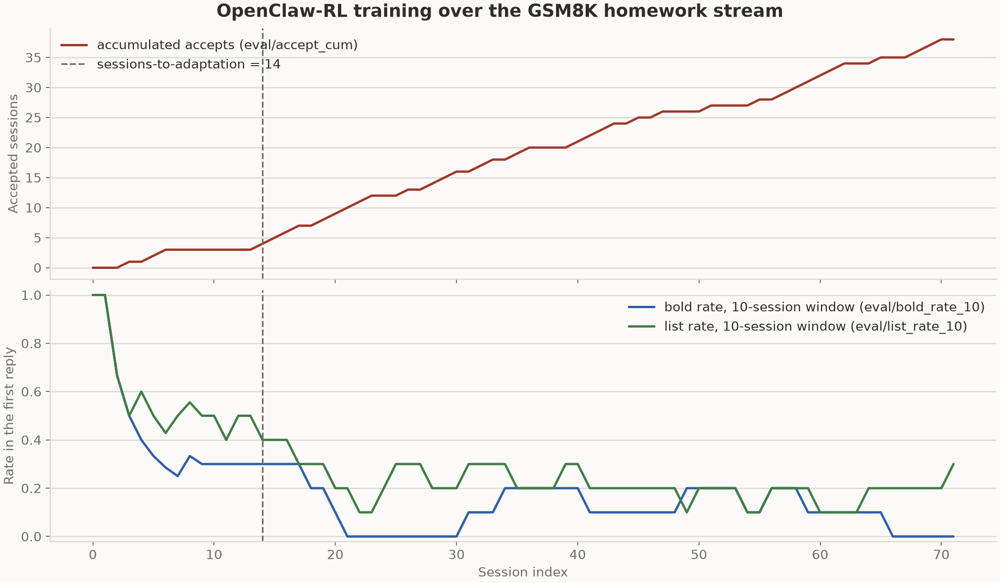
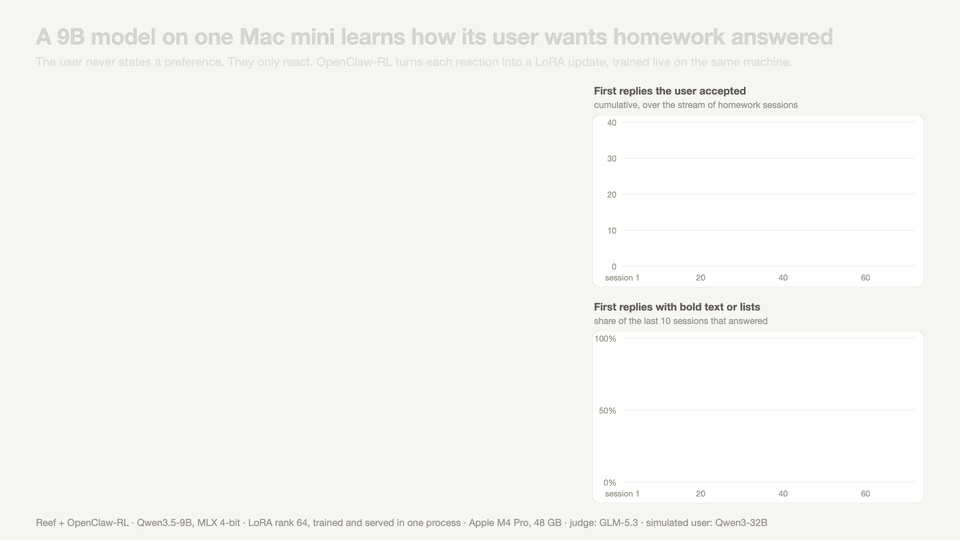

# OpenClaw-RL on Reef

This example implements the harness side of
[OpenClaw-RL](https://arxiv.org/abs/2603.10165)'s personal-agent experiment.
OpenClaw-RL trains an agent from its ordinary usage: each turn is scored by
what the user did next, a follow-up that moves on counting as acceptance and
a complaint as rejection, and the policy updates while it keeps serving. The
method itself is the `openclawrl` recipe package (`recipes/openclawrl/`). Its
processor rebuilds sessions from the traffic Reef already records, judges
every completed turn through an independently deployed PRM, and turns accepted
hindsight hints into a training signal. No report call is required. The
processor prefers a stable, conversation-unique `x-reef-tag-session` value
and otherwise falls back to matching transcripts; this example's header shim
supplies the tag for the unmodified Hermes agent.

This directory is the experiment around that recipe: a simulated student
brings GSM8K homework problems to a real Hermes agent, one session after
another, and the metric is how many sessions the agent needs before its
answers match the student's taste. The student wants solutions that do not
look AI-written (natural prose, no bold, no lists) but still show every step
of a correct solution. It never states this preference, so the agent has to
learn it from the reactions.

The [`openclawrl` recipe page](../../../../docs/user-guide/recipes/openclawrl.rst)
documents the recipe's configuration. This README records the stream's
implementation details and the learning curve of a completed run.

```text
harbor-tasks/
  gsm8k-s000/ ... gsm8k-s071/   one stock Harbor task per session, in dataset order
    task.toml                    metadata, timeouts, agent network allowlist (judge only)
    instruction.md               what the agent is told
    environment/
      Dockerfile                 hermes-agent, pinned to a commit
      Dockerfile.judge           FROM the shared student service image, plus this session's problem.json
      docker-compose.yaml        main container + judge service
      problem.json               this session's question and gold answer
    tests/test.sh                copies the judge's /final verdict into the verifier output
harness/
  agent.py                       HermesStreamAgent: the reef-eval agent that runs one session
user_sim/
  personas.py                    the student persona and the strict acceptance criterion
  student_server.py              the judge service (HTTP), scripted or LLM-backed
  pyproject.toml                 packaged as openclawrl-user-sim
  Dockerfile                     the shared student service image, built by run.sh
results/
  learning_curve.py              per-session accept and style metrics, logged to W&B during a stream or exported afterwards
  2026-08-27-gsm8k-stream-qwen3-4b-thinking/
                                 the learning curve of a complete run
  2026-10-20-mlx-gsm8k-stream-qwen3.5-9b/
                                 the learning curve, training steps and demo of a run on one Mac
serve.yaml                       Reef/Slime configuration and the recipe's PRM endpoint
serve-mlx.yaml                   Reef/MLX configuration for one Apple Silicon Mac, with a hosted PRM
reply_probe.json                 hermes conversations for the candidate evaluation's reply probe (serve-mlx.yaml)
docker-compose.yaml              Reef, PRM and student-model containers with separate GPUs
run.sh                           builds the student service image, starts the stack, runs the stream
restamp.sh                       re-pins the 72 tasks to user_sim/'s content hash after a change there
pyproject.toml                   makes harness/ importable
```

## The ordinary agent

The agent is a stock `hermes-agent` install inside each task container. It
is driven through its command line, one quiet `hermes chat -q` turn per
student message (`--resume latest` after the first, so the model keeps its
own earlier replies in context), with its home directory on the stream's
state mount. The one-shot `hermes -z` cannot be used for this: it accepts
`--resume` but ignores it, so every turn would start a fresh conversation.
Hermes reads
its model endpoint from its own config and sends OpenAI-compatible chat
requests; it knows nothing about Reef, scenarios, or training.

The judge service plays the student. `student_server.py` runs the persona
from `personas.py`, reacts to each reply, and records the session. The
reactions come from the Qwen3-32B persona served by the stack, named by
`OPENCLAWRL_USER_LLM_URL` and `OPENCLAWRL_USER_LLM_MODEL`; the task
environments require both. A scripted line is the fallback when the LLM call
fails or when the LLM student starts dictating the math, which the persona
forbids: a styled reply gets the complaint, a clean one gets the request to
save the file.

## The homework stream

The stream is a [reef-eval task stream](https://github.com/Human-Agent-Society/reef-eval):
an ordered folder of ordinary Harbor tasks that reef-eval runs strictly in order,
with one directory (`$REEF_EVAL_STATE_DIR`) mounted into every position. The
agent carries state across sessions, so the sessions cannot be run as
independent trials.

The committed stream has the original OpenClaw-RL paper's 72 GSM8K problems
as 72 tasks. Each task is a stock Harbor task whose environment carries only
its own `problem.json`; the judge runs as a compose service built from one
shared image.

The student service scores each session on the agent's first solution reply, under
the strict criterion in `personas.py`: no AI-style markers (bold, headers,
bullet or numbered lists, horizontal rules, tables, `\boxed`, "final
answer:"), at least two visible calculation steps, and the gold answer
present.

Weights and memory are two separate ways the agent can adapt. The paper's
numbers are for weights only, so `hermes_memory` is off by default.

## The changes needed for Reef

`HermesStreamAgent` (`harness/agent.py`) owns one session per stream
position. Around the unmodified agent it makes three changes:

1. It runs a small header shim (`reef_client.serve`) on the host and points
   hermes's model endpoint at it. Hermes cannot set the `x-reef-scenario`
   or `x-reef-tag-session` header itself, so the shim attaches the scenario
   and stable conversation tag, then forwards the request to Reef.
2. It mints a Reef scenario id at position 0 and writes it to
   `$REEF_EVAL_STATE_DIR`. One stream is one scenario, which is one chain of
   runtime load IDs in Reef.
3. It writes the hermes config at the start of every position, with context
   compression, reasoning display and the tirith scanner turned off (the
   reply on stdout must be the answer alone).

The runtime flow is:

```text
reef-eval starts the task container and the judge service for the next session
  -> the harness reads the student's message from the student service
  -> hermes runs one turn; its model calls go through the shim to Reef
  -> the SGLang backend records the sampled tokens, loss mask, log-probabilities, and top-K capture
  -> the harness posts hermes's reply to the student service, and the student reacts
  -> on the next model call, the processor uses the session tag to bind the preceding call to its following tool result or user reaction
  -> the PRM judges that next state and may propose a hindsight hint
  -> batch_size judged turns form one batch; the top-K select loss trains the policy
  -> Megatron performs one optimizer step and synchronizes weights to SGLang
  -> the next session runs on the updated weights
```

## Setup (once)

You need a GPU host with seven available GPUs, Docker, and `uv` (for `uvx`,
which runs reef-eval). The example's `docker-compose.yaml` assigns physical GPU 1
to the PRM, GPU 2 to the student model, and GPUs 3–7 to Reef/Slime, leaving GPU 0
free. Slime reserves four GPUs for the Megatron actor (tensor parallel 4) and
one for policy rollout. Its CPU driver reserves no model GPUs itself. Adjust
Compose device assignments for your host; keep the three pools disjoint.
This example is a single-host deployment.

Compose starts and health-checks the independent model services, waits for PRM
readiness before starting Reef, and waits for all three services before the
harness runs. Reef starts a local Ray runtime for Slime and connects its HTTP
service to the training-owned inference engine. Reef shutdown stops its own
runtime; `docker compose down` stops the entire example, including PRM and the
student model.

Set `RAY_ADDRESS` only to connect Slime to an external cluster, which Reef leaves
running. That cluster must exclude the PRM/student GPUs: the Reef container's
GPU visibility does not constrain an external cluster. An unavailable external
address is an error. To launch Reef directly, first start the independent PRM
and student model, then restrict Reef's local pool, for example:
`CUDA_VISIBLE_DEVICES=3,4,5,6,7 reef serve -c recipes/openclawrl/examples/openclawrl/serve.yaml`.

```bash
docker build -f docker/Dockerfile.reef -t reef-openclawrl .
hf download Qwen/Qwen3-4B-Thinking-2507 --local-dir ~/models/Qwen3-4B-Thinking-2507   # policy and PRM
hf download Qwen/Qwen3-32B --local-dir ~/models/Qwen3-32B                             # the student
pip install uv
```

Qwen3-4B-Thinking-2507 serves as both the policy and the PRM, as in the
reference run script. The PRM is the frozen base model on its own engine;
the policy is trained. Qwen3-32B plays the student.

Two more things to check on a host you did not set up yourself. reef-eval needs
Python 3.12 or newer; if `uvx` picks an older interpreter, set
`UV_PYTHON=3.12`. And the repository root must not contain a stale
`reef.egg-info`, because it is mounted into the container and shadows the
installed package's entry points, which stops the sglang plugin from loading.

## Run

```bash
OPENCLAWRL_USER_LLM_URL=http://<host-ip>:30001 \
OPENCLAWRL_USER_LLM_MODEL=qwen3-32b-user-llm \
bash recipes/openclawrl/examples/openclawrl/run.sh
```

This builds the student service image, boots the training stack in Docker (about six
minutes on B200s), waits for it to become healthy, then runs the 72-session
stream through reef-eval. The stack keeps running after the stream ends.
Re-running the same command resumes the stream where the lab left off and
reuses the healthy stack.

The paths and names are constants at the top of `run.sh`: the models under
`~/models`, checkpoints under `~/reef-run`, and the task list (all 72 GSM8K
tasks). A few settings come from the environment, because the task
environments and other processes read them:

- `OPENCLAWRL_USER_LLM_URL` and `OPENCLAWRL_USER_LLM_MODEL` name the student
  model the stack serves on port 30001. The task environments require both,
  and reef-eval rejects every task when either is unset. Use the host's
  address, not localhost, because the student service calls it from inside a
  container.
- `WANDB_API_KEY=...` is forwarded into the stack for live training curves
  (also set `observability.wandb.enabled: true` in `serve.yaml`) and starts
  `results/learning_curve.py`, which logs the per-session verdicts into the same
  W&B group.

A reef process trains one scenario for its lifetime. Pointing a different
stream name, or a fresh run directory, at a stack that has already trained is
rejected with "training is already bound to scenario ...". Stop the stack
with `docker compose down` in this directory before switching streams or
starting a variant.

A stopped stack restarts from `$RUN_DIR`: the actor resumes its Megatron
checkpoint, the teacher is reloaded from the base HF weights, and the
committed head is republished. Two cases need a hand:

- A stop while Reef is committing a step (after the bridge has published its
  weights) leaves the bridge waiting for that commit, and every later batch
  is refused with "training marker is READY_TO_COMMIT; operator recovery
  required". The batch cannot be replayed (the judges sample), so start the
  training state over: stop the stack and move `checkpoints`,
  `artifacts.git`, `artifact-work`, `artifact-cache`, `agent-record` and
  `prm-records.jsonl` out of `$RUN_DIR`. The lab and stream state stay, and
  a re-run continues at the next position.
- The harness runs every container command, hermes included, as your user
  and hands the hermes home to you at the start of each position, so a
  killed run leaves nothing root-owned in `$RUN_DIR/lab/streams/<stream>/state`
  that reef-eval could not reset. A state directory written by an earlier
  harness may still need a one-time chown to your user.

### Reading a run

The reef-eval lab is at `~/reef-run/lab`. Each session's verdict is in
`trials/gsm8k-sNNN__*/verifier/final.json`, with the reward, the list of
violated rules, and the turn count. `results/learning_curve.py` turns those
verdicts into the stream's learning curve: whether the first reply was
accepted, which style markers the judge flagged (bold, bullets, numbered
lists), the cumulative accept count. While a stream runs with `WANDB_API_KEY`
set as mentioned above, `run.sh` runs the script in logging mode and each
session appears as one point in an `eval` run of the same W&B group as the
training run. After a stream, the same script exports those points to a CSV
and draws the figure the README keeps:

```bash
uv run --no-project --with matplotlib \
    recipes/openclawrl/examples/openclawrl/results/learning_curve.py \
    --lab ~/reef-run/lab --csv results/<run>/learning_curve.csv --plot results/<run>/learning_curve.png
```

## Run on Apple Silicon

`serve-mlx.yaml` runs the same stream on one Apple Silicon Mac. The policy
serves and trains in the Reef process on MLX, with no GPUs and no Docker
stack for Reef. The PRM judge (`z-ai/glm-5.3`) is called through OpenRouter,
so set `OPENROUTER_API_KEY`. The student model is a hosted model too: point
`OPENCLAWRL_USER_LLM_URL` and `OPENCLAWRL_USER_LLM_MODEL` at it.

```bash
uv pip install -e ".[mlx]" -e ./third_party/reef-client
reef serve -c recipes/openclawrl/examples/openclawrl/serve-mlx.yaml
```

Run `reef serve` on the host, not in a container. `run.sh` starts the GPU
Compose stack, so it does not run this config. Use its other steps instead:
build the student service image, then run its `reef-eval stream` command
with `REEF_URL=http://<LAN address>:8904` and `REEF_TOKEN=reef-local`. The
task containers reach the service over the machine's LAN address, so do not
use localhost.

Some Docker runtimes, such as colima, cannot route a container to the
host's LAN address. With these runtimes, do these steps:

- Keep `reef_url` at the LAN address. The shim runs on the host and uses it.
- Add `"shim_host": "host.docker.internal"` to the agent `kwargs`. Hermes
  then calls the shim at that name.
- Set `extra_allowed_hosts` to `["host.docker.internal"]`.
- Set `OPENCLAWRL_USER_LLM_URL` to a `host.docker.internal` address if the
  student model runs on the host.

Serving on a Mac is slower than on GPUs. A turn can wait for a whole
training step and the candidate evaluation, which together take about 15
minutes on a 9B model. Set `OPENCLAWRL_TURN_TIMEOUT_S` to 1800, and keep
`pipeline.record2record.config.session_ttl_s` at the 1800 that
`serve-mlx.yaml` sets. [Train on Apple Silicon with
MLX](../../../../docs/user-guide/mlx.rst) documents the backend, its options
and the sizing measurements.

To resume a stream after `reef-eval stream` stops, keep Reef running and
start the stream again on the remaining tasks with the same `--name`. Set
`OPENCLAWRL_SCENARIO` to the scenario that the stream used, as
`/reef/status` shows it. Otherwise the stream mints a new scenario, and Reef
refuses it because the process already trains the first one.

## Results

### GSM8K homework stream

`results/2026-08-27-gsm8k-stream-qwen3-4b-thinking/` is a run result from the above.

| Setting | Value |
| --- | --- |
| Task | the 72-session GSM8K homework stream, hermes memory off |
| Model | `Qwen3-4B-Thinking-2507` as the policy and as the PRM |
| Student | the `Qwen3-32B` persona |
| Hardware | the seven-GPU reference layout: a tensor-parallel-4 actor, one rollout engine, one PRM engine, one engine for the Qwen3-32B student |
| Batch | 16 judged turns per training step |
| Responses | up to 8192 tokens in a 65,536-token context |
| Objective | top-K select loss, PPO clip 0.2 / 0.28, `w_rl` 1.0, `w_opd` 1.0, top-4 capture, `sequence_optimal` hint selection |
| Sampling | temperature 0.6, top-p 0.95, top-k 20 |
| Optimizer | Adam, lr `1e-5` constant, weight decay 0.1, betas 0.9 / 0.98 |
| Checkpointing | one checkpoint per version, weights hot-swapped after each step |
| Tracking | per-session verdicts logged to W&B online; training metrics not tracked |


A session passes when the agent's first solution reply already matches the student's preferences, with the work shown and the correct answer. The student wants homework that does not look AI-written, so a reply that uses bold text or a bullet or numbered list draws a complaint. The bold rate and the list rate measure this habit over the run, as the fraction of the last ten sessions whose first reply still contains bold text or a list. From the curves we see both fall as training goes on, and the run reaches the paper's adaptation criterion (three passed sessions in a row) at session 14.


The demo above replays two sessions from this run. In session 1 the student
rejects a formatted reply, reef keeps the training going, and by session 16
the first reply passes directly.

### GSM8K homework stream on Apple Silicon

`results/2026-10-20-mlx-gsm8k-stream-qwen3.5-9b/` is a run of `serve-mlx.yaml`
on one Mac over the whole stream.

| Setting | Value |
| --- | --- |
| Config | `serve-mlx.yaml` as committed, with machine-specific paths and port |
| Task | the 72-session GSM8K homework stream |
| Model | `mlx-community/Qwen3.5-9B-MLX-4bit` as the policy, thinking off |
| PRM | `z-ai/glm-5.3` through OpenRouter, 3 votes per turn |
| Student | `qwen/qwen3-32b` through OpenRouter |
| Hardware | one Mac mini, Apple M4 Pro, 48 GB of memory |
| Hermes turn timeout | 900 s for sessions 1 to 14, then 1800 s (`OPENCLAWRL_TURN_TIMEOUT_S`) |



The run reached the adaptation criterion after 14 sessions: sessions 15,
16 and 17 passed. The habit held for the rest of the stream.

| Sessions | Passed | Answered first replies with bold text or a list |
| --- | --- | --- |
| 1 to 14 | 3 of 14 | 8 of 11 |
| 15 to 40 | 17 of 26 | 6 of 26 |
| 41 to 72 | 18 of 32 | 7 of 31 |

The untrained model passed none of its 18 tries: the 2 sessions it served
and the 16 problems of the held-out check.

Each candidate was checked on the 16 held-out problems before it served
(`training_steps.csv`). Steps 1, 2, 3 and 6 scored 7 or 8 of 16 and were
selected. Steps 4 and 5 scored 3 of 16 and were held, so serving kept the
weights of step 3. From step 7 on, every candidate scored 5 of 16 or less
and was held, so the weights of step 6 served sessions 21 to 72. In this
run, a held step's gradient stayed in the optimizer state, and the next
step started from those moments. Reef now restores the optimizer state when
it rejects a candidate. This run does not measure the effect of that change.

Other observations from the run:

- Sessions 10, 14 and 55 got no first reply: the first turn reached the
  turn timeout. The first turns of sessions 10 and 14 waited for a training
  step and its candidate evaluation, about 16 minutes, against a 900-second
  timeout. Session 55 reached the 1800-second timeout; the records do not
  show why.
- Sessions 2 and 5 reached the turn timeout in a later turn, after the
  judged first reply.
- The stream ran for about 12 hours. A training step took about 10
  minutes and its candidate evaluation about 5.5 minutes, and serving
  waited for both.

`learning_curve.csv` holds the per-session verdicts, written by
`results/learning_curve.py`. `training_steps.csv` holds one row per training
step: the stream sessions finished before the step, the outcome of the
candidate evaluation, the rows kept and left out, the loss, the adapter
change, the advantage signs and the probe metrics.



The demo replays session 2, which the student rejects for its formatting,
and session 23, which passes after 6 training steps. `demo.mp4` is the same
demo in 1080p.

## Configuration ownership

The Reef YAML contains no `service` or `services` sections. HTTP settings use
`reef.*`; Reef assembles inference and training. OpenClawRL's judging stage
consumes an independently deployed PRM through
`pipeline.record2record.config.prm_url` and
`pipeline.record2record.config.prm_tokenizer_path`. The tokenizer must match
the served PRM. CLI overrides use the same paths, for example:

```bash
reef serve -c recipes/openclawrl/examples/openclawrl/serve.yaml \
  --pipeline.record2record.config.prm_url http://prm-host:23001 \
  --pipeline.record2record.config.prm_tokenizer_path /models/prm-tokenizer
```

The example's Compose file owns PRM and student-model launch arguments, health
checks and GPU assignments. Configure native SGLang options in those containers'
commands. The student-model endpoint belongs to the user-simulation harness;
Reef does not receive it. To use an existing PRM in the Compose example, remove
the `prm` container and Reef's Compose `depends_on: prm` entry, then update the
two PRM fields under `pipeline.record2record.config`. PRM request timeouts and
scoring errors remain the OpenClawRL recipe's responsibility.
