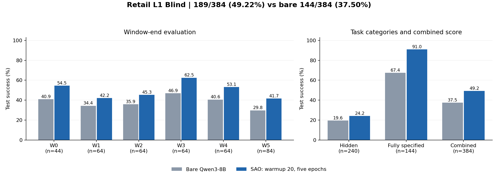
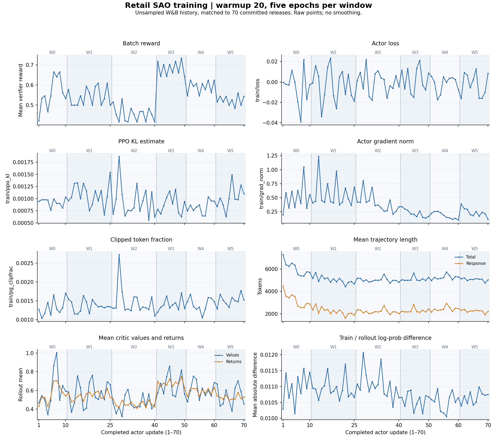

# ServeLearnBench Retail L1 with SAO

This example runs the Retail L1 scenario of ServeLearnBench through Reef the way the benchmark's own runner does.
Every window runs in order: a window's serving tasks are trained on in batches, then its held-out test tasks run against the frozen weights, and the weights carry into the next window.
The summary reports the official Hidden and Fully Specified test scores separately.
It also reports the combined mean over all test tasks.
It implements the Retail part of [issue #893](https://github.com/Human-Agent-Society/reef/issues/893); the other scenarios and the OPD comparison are outside this example.

The benchmark dependency is pinned in `pyproject.toml`.
Its official agent loop owns environment resets, tools, budgets, termination, and verification.
The harness connects the model transport to Reef and reports the official scalar reward.
Hidden rules, ground-truth actions, and verifier details never enter SAO feedback.

## Latest experiment: warmup 20, five epochs per window

The completed Qwen3-8B run scored **189/384 (49.22%)**, versus **144/384 (37.50%)** for the bare model: **+11.72 percentage points**.
Every window improved over the recorded baseline.



### Training and evaluation protocol

Each window receives five passes over its serving tasks before its held-out tests run once.
Each pass collects fresh tool-use trajectories from the current actor, with one trajectory per task.
It does not replay the same sampled trajectories five times.
Actor, critic, and optimizer state continue from W0 through W5.
Tests use frozen weights and submit no training feedback.

| Configuration | Completed experiment |
| --- | --- |
| Model / GPUs | Qwen3-8B / 2×B200, local colocate port |
| Actor / critic | Full-parameter actor / self-attention frozen in the critic |
| Mode / rollout seed | Blind / 42 |
| Global / micro batch | 64 / 8; each epoch trains its smaller window tail |
| Context / output per call | 40,960 / 16,384 tokens |
| Task budgets | 100 model calls, 50 budgeted tool calls, 256,000 output tokens |
| Sampling | Temperature 1, top-p 1; one rollout per task per epoch |
| Learning rates | Actor `1e-6`, critic `5e-6` |
| Warmup | 20 extra passes on the first 64 W0 trajectories, with two critic updates per pass |
| Normal training | Two critic updates and one actor update per batch |
| Total | 720 unique serving tasks, 3,600 fresh trajectories, 70 actor updates, 180 critic updates |

Warmup performs 40 critic optimizer updates while the actor stays fixed.
The first normal update reuses those 64 trajectories and computes values and advantages again.
Warmup occurs once, before W0 training, and does not repeat at window boundaries or restarts.
The five epochs produce 10, 15, 15, 10, 10, and 10 actor updates across W0–W5.

These results use local colocate commit `fb5b52b0` with experiment overlays for five epochs, checkpoint retention, and optimizer recovery.
The runtime is separate from this PR's split stack and #1034.
The checked-in launcher still defaults to one epoch, warmup 1, and global/micro batch 64/16.
This result update does not add the experiment overlays to that launcher.

### Test results

| Window | Tests | Bare model | Warmup 20, five epochs | Gain (pp) |
| --- | ---: | ---: | ---: | ---: |
| W0 | 44 | 18/44 (40.91%) | 24/44 (54.55%) | +13.64 |
| W1 | 64 | 22/64 (34.38%) | 27/64 (42.19%) | +7.81 |
| W2 | 64 | 23/64 (35.94%) | 29/64 (45.31%) | +9.38 |
| W3 | 64 | 30/64 (46.88%) | 40/64 (62.50%) | +15.63 |
| W4 | 64 | 26/64 (40.63%) | 34/64 (53.13%) | +12.50 |
| W5 | 84 | 25/84 (29.76%) | 35/84 (41.67%) | +11.90 |
| **Combined** | **384** | **144/384 (37.50%)** | **189/384 (49.22%)** | **+11.72** |

| Official task category | Bare model | Warmup 20, five epochs | Gain (pp) |
| --- | ---: | ---: | ---: |
| Hidden | 47/240 (19.58%) | 58/240 (24.17%) | +4.58 |
| Fully Specified | 97/144 (67.36%) | 131/144 (90.97%) | +23.61 |

The combined score weights all 384 tests by task count, using each window's own post-training checkpoint.
It does not measure final-checkpoint retention on earlier windows or benchmark-wide performance across scenarios.
Percentage-point gains use unrounded fractions.

Historical completed runs provide context:

| Run | Epochs per window | Actor updates | Successes / tests | Combined score |
| --- | ---: | ---: | ---: | ---: |
| Bare Qwen3-8B | 0 | 0 | 144/384 | 37.50% |
| Warmup 5, seed42 | 1 | 14 | 161/384 | 41.93% |
| Warmup 5, seed43 | 1 | 14 | 155/384 | 40.36% |
| **Warmup 20, seed42** | **5** | **70** | **189/384** | **49.22%** |

### Training curves



The curves use the full W&B history, without sampling or smoothing.
All 70 plotted releases match the metrics in the committed campaign records.
The horizontal axis counts completed actor updates, not W&B events, epochs, or critic warmup passes.
Dashed lines mark window boundaries. Batch reward is a training metric, not a held-out test score.
Trajectory lengths are batch means, not maximum context lengths.

The export contains no critic-loss series or intermediate warmup-fit series.
The values/returns panel shows rollout means and cannot establish per-token critic calibration.
The warmup-only checkpoint remains saved. Ordinary training checkpoints were removed after evaluation.

### Interpretation and limits

- The run gains 45 successful tests over the bare model. Fully Specified tasks account for 34 gains, and Hidden tasks account for 11.
- Hidden success remains 24.17%. The stronger Fully Specified gain is consistent with better execution of supplied constraints, but does not establish robust hidden-rule discovery.
- The recorded PPO KL estimate stays between 0.00056 and 0.00187. Actor gradient norms and losses remain finite across all 70 updates.
- Mean response length falls early, then mostly remains around 2,000–3,000 tokens. Shorter responses alone do not explain improved test scores.
- Training rewards change with the window's task distribution. Their jumps cannot establish learning progress across different windows.
- This run changes both warmup and training epochs relative to warmup 5. It does not isolate either change's causal effect.
- The new configuration has one training seed. The baseline also has one sampling seed, so these results do not establish repeatability or statistical significance.

### Data and checks

[Training curve data (CSV)](results/retail_l1_warmup20_epoch5_training.csv) and
[configuration and result counts (JSON)](results/retail_l1_warmup20_epoch5_summary.json) accompany the figures.
The JSON records the source checksum, benchmark revision, runtime commit, and W&B run identifier.
Readers can view the figures without a W&B account.

Record checks found 70 committed actor updates, 3,600 training trajectories, 384 unique test IDs, and 189 successful tests.
The total of the recorded critic updates is 180, including 40 warmup updates.
The final Slurm job, `1610937`, completed with exit code 0 on October 31, 2026.
The baseline and historical counts come from the [previous result report](https://github.com/Human-Agent-Society/reef/pull/911#issuecomment-6478393787).

## Layout

```text
servelearnbench/
  run.sh          starts reef serve, then runs the campaign
  run.py          the campaign: the ordered split, training batches, checkpoint resume, results.jsonl
  batching.py     keeps each declared task batch together, including window tails
  recipe.py       adds critic warmup passes before the first batch's normal SAO update
  serve.yaml      the Reef stack: Qwen3-8B actor and critic, SAO, exact-token episodes
  harness/
    config.py     shared batch, micro-batch, warmup, and context settings
    campaign.py   durable results and category scores
    agent.py      the benchmark's LLM interface over reef_client and its episode loop with a turn limit
    report.py     the score report against an episode's inference receipts
```

## Experiment settings

| Setting | Pilot |
| --- | --- |
| Actor | Dense Qwen3-8B, full-parameter updates |
| Critic | Qwen3-8B value model; self-attention frozen, other parameters trainable |
| Sample / batch | One complete task trajectory; up to 64 tasks per training batch; micro batch at most 16 |
| Warmup | One extra critic-only pass over the first batch, then reuse it for normal SAO training |
| Critic cadence | Two critic updates per batch, including warmup |
| Actor cadence | One update per batch, including the first batch after its extra warmup |
| Learning rates | Actor `1e-6`; critic `5e-6` |
| Evaluation | Each window's tests against the frozen weights at that window's end; no test reports or updates |
| Context / per-call output | 40,960 / 16,384 tokens |
| Episode budgets | Official 100 turns, 50 world-tool calls, 256,000 output tokens |

This is a dense, batch-64 adaptation of SAO. It is not a reproduction of the paper's MoE, batch-128 experiment.
Critic warmup is not critic pretraining. No pretrained value checkpoint is assumed.
The existing two-critic-update timing is preserved; this example does not claim the paper specifies that timing exactly.

All methods use the same generation settings and task split.
The context and per-call output limits above differ from the benchmark's default per-call limit of 65,536 tokens.
The default episode-level budgets remain unchanged.
Use `--max-steps` to set a different model-turn limit for every serving and test task.
The results record that limit. Apply the same limit to every compared method.
A length-limited model turn can continue through the official agent loop.
Task-level budget exhaustion and context overflow retain the official reward and ending reason.
The driver neither drops these trajectories by length nor adds value bootstrapping.
An unassemblable training trajectory fails explicitly.

Reef's chat handler serves each episode from its exact sampled token IDs (`inference.handler-config.episode_continuation`).
A later call appends only the new observations and turn delimiters as masked context.
This avoids Qwen3 history re-rendering, which otherwise removes earlier reasoning from the training mask.
Blind, Oracle, and SAO use the same setting.

## Install and run

Use Python 3.12 and Reef's supported Slime/SGLang environment from [docker/README.md](../../../../docker/README.md).
Install Reef and its runtime pin as described there. From the repository root, install this example:

```bash
uv pip install -e recipes/sao/examples/servelearnbench
```

Keep the code in project storage. Put model files, checkpoints, logs, and runtime caches on scratch storage.
Set paths to a downloaded Qwen3-8B checkpoint and two fresh, empty directories:

```bash
export MODEL_DIR=/scratch/your-project/models/Qwen3-8B
export CHECKPOINT_DIR=/scratch/your-project/retail-w1/sao-seed42
export REEF_WORK=/scratch/your-project/retail-w1/runs/sao-seed42
export SAO_GPUS=4
bash recipes/sao/examples/servelearnbench/run.sh
```

`SAO_GPUS` sets tensor parallelism for the actor, critic, and inference engine.
The actor and critic share training GPUs. Serving reserves a separate set of GPUs after the training-component refactor (#922).
Allocate `2 * SAO_GPUS` GPUs in total; `SAO_GPUS=1` needs two GPUs.
The default is a launch configuration, not a measured minimum GPU requirement.
Allocate the GPUs before running the script. Do not run the service on a login node.

The defaults are 100 model calls and at most 16,384 output tokens per call.
Thinking and the visible reply share the output budget; the configured context limit is 40,960 tokens.
An episode that reaches the limit ends with the official context-overflow ending and keeps its score.

For baselines, run `METHOD=blind` or `METHOD=oracle` with fresh directories and a separate stack.
Both baselines use the same stack without reports; their training backend stays idle.
Oracle receives the official window bulletin; Blind receives no extra context.
Each stack starts from the same base checkpoint. No method receives test feedback for training.

```bash
METHOD=blind bash recipes/sao/examples/servelearnbench/run.sh
# Change REEF_WORK and CHECKPOINT_DIR before the next run.
METHOD=oracle bash recipes/sao/examples/servelearnbench/run.sh
```

Each trainable serving task submits one report containing every ordered inference receipt.
The driver collects up to 64 tasks within one window, saves the batch, and submits its reports.
Each report names the complete task list for its batch. The record stage waits for every declared task.
The pipeline takes that complete group as one job; each trajectory keeps its own reward.
The grouping does not create prompt comparison groups or change the SAO objective.
It then waits for training and weight publication.
Job submission and critic-only checkpoints do not count as completed actor updates.
The driver waits for the actor checkpoint, the job's completion, and reopened inference admission.
No task spans a weight update. Test tasks use the final published actor and never submit reports.
Keep `save-interval: "1"` so each completed batch publishes weights.
A training timeout or service error aborts the run.

The shared defaults are `SAO_BATCH=64`, `SAO_MICRO_BATCH=16`, `SAO_WARMUP=1`, and `SAO_CONTEXT=40960`.
The launcher and result records use the same configuration.
`SAO_CONTEXT` cannot exceed 40,960 because this example does not enable YaRN.
The configured full batch must be divisible by the micro batch; this stack uses data parallel size one.
A window tail uses its actual sample count. Its final micro-batch may be smaller than 16.
For example, a 57-task tail uses micro-batches of 16, 16, 16, and 9. Loss normalization uses 57 samples.
`SAO_WARMUP` adds critic-only passes over the first batch. It does not consume extra tasks or restart at window boundaries.
Each warmup pass performs two critic updates and no actor update.
The same first-batch trajectories then receive one normal SAO pass: two critic updates and one actor update.
Tokens, rewards, and rollout log-probabilities stay unchanged. The training backend computes values and advantages again for each pass.
The actor stays unchanged during warmup, so these trajectories still come from the current actor when normal training starts.
With the default warmup of one, the first batch receives four critic updates in total and one actor update.
Setting `SAO_WARMUP=0` skips the extra pass; larger values repeat critic warmup on that same first batch.
This warmup is an implementation choice, not value pretraining.

A batch never spans two windows. Every window's remaining serving tasks train as one smaller final batch.
The driver waits for that batch's checkpoint and serving weights before starting the window's tests.
Retail L1 has six windows with 79, 140, 140, 120, 120 and 121 serving tasks, plus 384 test tasks.
At batch 64, all 720 serving tasks train in 14 normal batches; 208 tasks belong to the six smaller final batches.
The default run has 14 actor updates and one extra critic-only pass: 15 training passes across 14 jobs.
W0 warms up on its first 64 trajectories, trains actor and critic on those same trajectories, then trains the remaining 15.
A W1-only run warms up on its first 64 trajectories and has three actor updates on batches of 64, 64, and 12 tasks.
A small final batch is a full optimizer step at the configured learning rate, so it changes the update count and gradient noise.
`--windows 1` selects W1. `--windows 1,2` selects two windows and carries training state between them.
Window indices must be unique and increasing. Gaps are allowed.
The launcher checks the plan before starting the GPU service and rejects a training plan with no serving tasks.
A SAO plan with no actor update fails with an error, including smoke plans.
Use `--check-only` with `run.py` to inspect a plan without starting Reef:

```bash
python recipes/sao/examples/servelearnbench/run.py --method sao --output /scratch/your-project/results.jsonl --check-only
```
The summary records per-window test scores, trained task counts and ending reasons, including budget and context endings.

## Low-cost smoke checks

First run the CPU tests from the repository root:

```bash
python -m pytest tests/recipes/sao/test_servelearnbench.py
```

These tests run the official Retail verification with scripted inference and the real SAO sample assembly.
They need the benchmark installed and do not establish GPU training or benchmark performance.

For the exact-token history check, point Reef's handler test at a downloaded Qwen3 tokenizer:

```bash
REEF_TEST_QWEN_TOKENIZER="$MODEL_DIR" python -m pytest tests/inference/test_chat_episode_continuation.py
```

For a GPU wiring check, allocate two GPUs, use Qwen3-0.6B, and use fresh directories.
Use a short allocation, including a preemptable allocation when available:

```bash
export MODEL_DIR=/scratch/your-project/models/Qwen3-0.6B
export SAO_GPUS=1
export SAO_BATCH=2 SAO_MICRO_BATCH=2 SAO_WARMUP=1
bash recipes/sao/examples/servelearnbench/run.sh --smoke --max-steps 20 --max-tokens 64
```

This runs the first window only: three serving tasks and two test tasks.
Smoke selects up to `max(2, 2 * SAO_BATCH - 1)` serving tasks to exercise a partial batch.
Each task has at most 20 model calls, with at most 64 output tokens per call.
The first two serving tasks warm up the critic, then train actor and critic using the same trajectories.
The one-task tail also trains actor and critic. This smoke produces three checkpoints and two actor updates.
The output explicitly marks the run as smoke. Do not compare its score with the 8B pilot.
Restore `SAO_BATCH=64 SAO_MICRO_BATCH=16 SAO_WARMUP=1` and the 8B model for the pilot.

## Results and recovery limits

`REEF_WORK/results.jsonl` contains configuration, scored episodes, committed training releases, and a summary.
Episode rows include traces, token usage, inference receipts, ending reasons, and producing weight versions.
Training rows record the actual `batch_size` and the actor checkpoint for each completed job.
`training_releases` and `actor_updates` count actor updates; `critic_only_batches` counts extra warmup passes.
Reef's release history also contains each critic-only checkpoint. Slime records progress between these checkpoints within the first job.
The summary counts `partial_batch_tasks`; `untrained_tail_tasks` is zero.
`test_score` is the combined mean of all test rewards, multiplied by 100; `window_scores` holds the same per window.
These combined means mix categories and are not the official category scores.
`category_scores` and `window_category_scores` contain the Hidden and Fully Specified means and task counts.
Each category uses a mean over its test tasks, not an unweighted mean of window scores.
An absent category has count zero and score `null`.
Serving rewards never contribute to test scores.
`REEF_WORK/reef.log` contains service and training diagnostics.

Every update saves actor and critic checkpoints, including optimizer state.
The example caps retained checkpoint storage at 1 TiB with a 10 GiB free-space floor.
Adjust these options in `serve.yaml` if your allocation differs.
Copy checkpoints you need to retain before your scratch purge deadline.

To resume, retain the original `REEF_WORK`, `CHECKPOINT_DIR`, `MODEL_DIR`, and scenario name.
Keep the same window selection, model, sampling configuration, batch sizes, and warmup.
Append `--resume` to the original command:

```bash
bash recipes/sao/examples/servelearnbench/run.sh --windows 1 --resume
```

Reef restores the model, optimizer, training progress, and inference weights from its saved state.
The campaign checks its configuration and committed release IDs against that state.
Completed batches and test tasks are skipped. An unreported partial batch is collected again.
Its previous result rows are saved in `results.interrupted-*.jsonl` for inspection.
A fully collected pending batch keeps its original receipts; identical reports can be sent again without duplicate training.
A restart can assign a new runtime load ID to the same restored weights.
The campaign accepts that ID only after checking the committed training history.

Use `--stop-after-batches N` to stop after N completed jobs with actor updates.
The first boundary includes both the extra warmup passes and the first normal SAO update.
Remove that option when resuming. For a small checkpoint-resume check, use fresh directories and the 0.6B smoke configuration:

```bash
bash recipes/sao/examples/servelearnbench/run.sh --smoke --max-steps 20 --max-tokens 64 --stop-after-batches 1
bash recipes/sao/examples/servelearnbench/run.sh --smoke --max-steps 20 --max-tokens 64 --resume
```

Resume requires campaign format 4, which reuses the first batch after critic warmup.
Older campaigns cannot resume under this changed training schedule.
The first job saves a checkpoint after every warmup pass and after its normal SAO pass.
After a restart, Slime continues from the last saved pass. The driver keeps the same task reports and waits for the actor checkpoint.
The driver does not repair incomplete optimizer checkpoints.
If Slime reports an ambiguous interrupted training job, follow the [backend recovery instructions](../../../../docs/user-guide/troubleshooting.rst).
A fresh run still requires empty directories. Never start two Reef services on the same storage.
